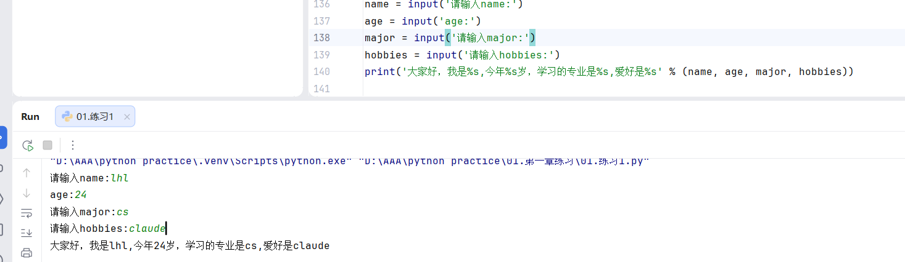

# Python笔记

# 1\.数据存储与运算

7


8\.


- `.idea` 文件夹：这是 PyCharm 软件专属的“记忆大脑”，专门用来保存你在这个项目里的个人配置（如主题颜色、字体大小、窗口布局等）。切记不要手动删除或修改，否则你的 PyCharm 会“失忆”，恢复到默认界面。

- `.venv` 文件夹：这是项目的“独立小仓库”（虚拟环境），里面包含了一份迷你的 Python 解释器以及你未来用 `pip install` 下载的所有第三方包。它的作用是隔离环境，防止不同项目之间的包版本冲突。平时无需理会，更不要手动进去改文件。

- `01.第一章练习` 文件夹：这是属于你自己的“分类收纳盒”，纯粹为了帮你条理清晰地管理学习代码。你可以根据自己的习惯随意新建、重命名或删除。（注：以后写 Python 代码文件时，建议文件名只用英文、数字和下划线，避免中文带来的潜在报错）。

- `main.py` 文件：这是你正式编写 Python 代码的“草稿本”，本质上就是一个后缀为 `.py` 的普通文本文件。你可以随意修改里面的内容，或者直接删除它换成你自己命名的练习文件。

9\.


**字面量**类似于C语言的常量，但不完全相同

python严格区分大小写，（因为语法比较简单），True,Flase首字母都是大写。本质数字类型，设计数学运算自动转化为01

**变量**：用来存储数据的容器（不是数据），通常存储会变化的值


11\.

**标识符**：为变量，函数，类的元素起的名字

规范（非强制）：1\.见名知意2\.多个部分下划线链接（蛇形命名法）3\.全部小写


python的print自带换行，如果不想换行可以写成print（a,end = ' '）

python的单引号双引号完全等价，但是推荐优先使用单引号

三引号的内容会完全原样输出。`'''` 和 `"""` 完全一样，没有任何功能区别。但官方（PEP 8 规范）强烈建议使用双三引号 `"""`

13\.

**数据类型：**

1. 字面量是“具体的值”，数据类型是“值的分类”。你在代码里写了一个 `3.14`（字面量），Python 一看，哦，带小数点的，直接把它归类到浮点数（数据类型）的盒子里。

2. 常见数据类型包括：`int`（整数）、`float`（浮点数）、`str`（字符串）、`bool`（布尔值）、`NoneType`（空值）。

3. `type(变量)` 用于查询数据类型。

**`type(变量)`**

1. 变量本身无类型，type\(变量\)是变量中存储的数据的类型，例如 a = 3\.14, 本身a无类型，但a存储3\.14是float，所以type（a）输出结果就是float

2. `type(变量)`：并不是在查这个变量的类型，而是在“顺着变量找数据，看它当前指向的数据是什么类型”。

3. 输出格式 `<class 'xxx'>` 是 Python 官方的标准格式，意思是“属于 `xxx` 这个类”。

4. 如果你只要单纯的类型名称，可以用 `type(变量).__name`\_\_。


**print\(isinstance\(a,int\)\) **判断bool值，如果a是int返回True,不是则返回False

14\.

**字符串**定义：单引号，双引号，三引号

使用单引号定义字符串时，里面不能再出现单引号',需要使用转义字符\\实现

例：\\'——\>'           \\"——\>"       \\n——\>换行         \\t——\>制表符，缩进一个制表符\(tab\)的大小

一个制表符8位，第一个\\t会补齐前面的不足八位长度，所以可能导致第一个制表符显示比剩余的段


tips:在 C 语言或 Java 里，用大括号 `{ }` 来区分代码块；而在 Python 里，用“缩进”（前面的空格）来区分代码块。

15\.

**字符串拼接：**两个字符串可以直接用\+拼接，不能直接用\+拼接字符串与非字符串


1. 隐式拼接：相邻的几个字符串（用空格隔开），Python 会自动把它们粘在一起。

2. 引号作用：引号只负责划定边界，不参与打印。

3. 嵌套规则：单引号里面可以放双引号，双引号里面可以放单引号；如果非要同种引号嵌套，必须用 `\` 转义。


- python多个字符串默认拼接"a""b""c"="abc"

- 引号外面的空格（代码排版），Python 全部无视。

- 引号里面的空格（数据内容），Python 一个不落全打印。

- 多个字符串拼接，不需要空格隔开（但加了也不影响运行，纯看个人排版习惯）。


tips：Python 是动态类型语言，简单来说：变量的类型，是在代码“运行”的时候，才自动决定的。而且同一个变量，随时可以变成别的类型。在定义的时候直接写a = 5即可，不能写int a = 5写死会报错。相反，c,java必须写成int a= 5，反而运行下面代码会报错。主要和指针有关。


1. C 的 `=`：把真实的数据，塞进固定名字的内存盒子里（类型定死）。

2. Python 的 `=`：把变量这个名字（引用/指针），绑在内存里生成的数据对象上。

3. 因为 Python 的变量全是底层指针（引用），所以它可以随时“撕下来，贴到另一块数据上”，这就是 Python 动态类型的底层真相。

**三种方式实现不同数据类型数据拼接**：`f-string` 格式化 和%格式化 和 手动转换格式`+` 号拼接


input可以输入



18\.运算符

1. `=` 和 `==` 千万别搞混：`=` 是赋值（把右边给左边），`==` 是判断（问左右相等吗）。

2. `/` 和 `//` 的区别：在 Python 里 `10 / 2` 结果是 `5.0`（带小数点的浮点数）；如果你只想要整数，用 `10 // 2`，结果才是 `5`（整数）。


**算术运算符**

python中，整除 // 向下取整即负无穷方向。 \-7//2 结果为\-4

Python 里，取余（`%`）的最终结果，永远跟“除数”的符号保持一致。   \-7%2结果为 1 因为除数（2）符号为正


**赋值运算符**

1. 只要用了 `/` 或者 `/=`，类型必定变成 `float`，而且会把变量原本的整数类型彻底“污染”。

2. `//` 能不能出整数，取决于两边的数据类型：

    - 如果两边都是整数：`10 // 3` 结果就是 `3`（int）。

    - 如果两边有任何一个是浮点数：`10.0 // 3` 或者 `10 // 3.0`，结果就是 `3.0`（float）。


    - 不可变数据类型（如整数、字符串）：`b = a` 只是复制了值的指向。后续修改 `a`，`b` 不受影响。

    - 可变数据类型（如列表、字典）：`b = a` 是真正的“共享”。后续修改 `a`，`b` 会跟着一起变。（根本原因指针（引用），指针在python里面叫引用）


这样设计的原因：

- 不可变类型（数字、字符串）：因为不可变，所以可以共享，省内存，还能当字典的钥匙，绝对安全。

- 可变类型（列表、字典）：因为允许原地修改，所以处理大量动态数据时速度快、不浪费内存。

- 这两者的分界线，决定了 Python 传给函数参数时，是“复制一份”还是“共享房间”。

- `b = a` 的本质：不管是什么类型，都是让 `b` 指向 `a` 当前指向的内存地址。

tips:`//=` 叫“增量赋值”。它有一个铁律：左边必须是一个“纯粹的变量名\.a//=2可以，int\(a\)//=2报错

**比较运算符**

- 在 Python 中，用 `==` 比较数值时，只看“数学大小”，不看“数据类型”。3 ==3\.0返回True

- 判断两个值相不相等：永远用 `==`（比如 `a == b`）

- 判断两个变量是否指向同一个对象（比如判断列表是不是同一个）：才用 `is`。

- 判断一个变量是不是为空（None）：永远用 `is`（比如 `if a is None:`）


**逻辑运算符**

在 Python 里，万物皆可判断真假：

- 假值（相当于 False）：`0`、`0.0`、`""`（空字符串）、`[]`（空列表）、`{}`（空字典）、`None`。

- 真值：除了上面那些假值，其他所有东西（包括负数、非空字符串）都是真值。

核心规则：

- `A and B`：如果 `A` 是假，直接返回 `A`；如果 `A` 是真，返回 `B`。

- `A or B`：如果 `A` 是真，直接返回 `A`；如果 `A` 是假，返回 `B`。


万物皆可判断真假

综合题：利用了and,or特性


tips:浮点数运算会出现精度损失


针对办法：


丢失精度原因：


# 2\.数据的逻辑处理

## 条件判断

**IF判断：**

语法:

**If True/False**

**条件成立时，执行\.\.\.**

tips：一个if判断语句是一个代码块，代码块是一组被作为一个整体来执行的语句。python通过缩进，C,java通过\{\}来界定边界

If else 

If elif\.\.\.elif  else 多条件判断，else可省略

tips:and优先级高于or，可以不加括号，但在开发中为了可读性，强烈建议加上括号。另外本题第二步可以省略%100只留%400


tips:`input()` 的本质：在 Python 中，`input()` 函数接收到的任何内容，默认都是字符串类型（`str`）。哪怕你输入的是数字 `5`，程序也会把它当作文字 `'5'` 来对待。所以下面如果不加int（）会报错


## 模式匹配

语法：

match\.\.\.case

作用：主要用来优化elif很多 == 的繁琐

最后一个 case \_：详单与else


## 循环

### **while循环**

- 当条件成立，执行循环体里面所有语句，之后再回来判断while是否成立（True）,成立继续执行循环体，不成立则跳出循环。

- while为false跳出循环时才去执行else里面的语句，else可有可无。

- `while...else` 的核心机制是：只有当 `while` 循环是因为条件变成 `False`（正常结束）而退出时，`else` 里的代码才会执行。如果是被 `break` 强制打断退出的，`else` 里的代码就不会执行。

- `continue`：跳过本轮，继续下一轮（只针对循环）。

- `break`：打断本层，跳出循环（只针对循环）。

- `return`：带着结果，夺门而出（只针对函数，一票否决权最大）。

- 函数一般用return，循环用continue、break


tips：断点的作用，就是给你的程序按下“暂停键”，让你在程序运行到这一瞬间时，像法医一样“解剖”代码，查看当时所有变量的值，从而找出 Bug。

- 程序崩溃了 👉 去报错行上方打断点。

- 结果算错了 👉 去循环内、计算公式前面打断点。

- 逻辑走丢了 👉 去 `if` 语句里面打断点。

### **for循环**

本质是轮询遍历机制，对一批内容逐个处理


练习


### **range数据集**

常在for循环用到

完整形态：`range(start, stop, step)`

这是最完整的写法，包含三个参数（用逗号隔开）：

- `start`：起始值（包含这个数字）。

- `stop`：结束值（**不包含这个数字！**这是初学者最容易踩坑的地方，俗称“包头不包尾”）。

- `step`：步长（每次增加或减少多少）。不写默认是 `1`。

- `range(N)`：从 0 开始，跑 N 次。适合只关心“跑几次”的场景。

- `range(A, B)`：从 A 开始，跑 \(B \- A\) 次。适合关心“数字本身是多少”的场景。

- “包头不包尾”：结束的那个数字不会出现在循环里，但循环的总次数，就是结束数字减去开始数字。

常用技巧：

- step为负数时，可以倒序输出

- 快速生成奇数/偶数，将步长设为2

- 如果你只给1个数，它认为那是 `stop`。

- 如果你给2个数，它认为那是 `start` 和 `stop`。

- 如果你给3个数，它才依次分配给 `start`、`stop`、`step`。

参考示例：


### **嵌套循环**

1. 执行规律：外层走一步，内层跑一圈（总次数 = 外层 × 内层）。

2. 变量变化：外层变量变化慢，内层变量变化快。

3. 打断规则：`break` 和 `continue` 默认只影响当前所在的那一层循环（内层）。

4. 嵌套层数：一般最多用 2\~3 层。嵌套太多（比如 4 层以上）代码可读性极差，不仅容易写错，运行速度也会慢（时间复杂度呈指数增长），通常需要思考用函数或其它算法优化。

5. 外层管行（控制换行 `print()`），内层管列（控制打印内容 `end=''`）。


当我们写for i in range\(10\)的时候，不用定义i，默认自动循环


**拆解一下 ****`for i in range(5):`**** 内部发生了什么？**

当你写下 `for i in range(5):` 时，Python 在后台悄悄做了三件事：

1. 调用 `range(5)` 生成一个序列：`[0, 1, 2, 3, 4]`。

2. 自动创建一个变量 `i`。

3. 每次循环，把序列里的下一个数字赋值给 `i`。

嵌套练习打印九九乘法表：


循环综合案例题

\.strip\(\) 防止空格干扰，比如不小心账号输入a 后面有个空格，加了strip（）可以正确识别


`random` 既是模块名，也是这个模块里一个函数的名字。\`random\(\)\` 和 `randint()` 都是 **`random`**** 模块里的函数**。

```Plain Text
import random

random.random()         # 生成 [0, 1) 内的随机小数
random.randint(1, 100)  # 生成 1 到 100 的随机整数，包含两端
```

看 `random.random()` 时，**点左边的 ****`random`**** 是模块，点右边的 ****`random`**** 是函数**。

如果写的是 `from random import random`，直接导入了里面的 `random()` 函数。这时再写 `random.randint(1, 100)`，Python 就会在这个函数上找 `randint`，于是报错。


如图，只有导入模块才能调用模块里面的方法。这里需要写成 import random

## `random` 模块

`random` 模块可以用来生成随机数、随机抽取元素和打乱顺序。

### 导入方式

```Plain Text
import random

random.random()         # 生成 0 <= x < 1 的随机小数
random.randint(1, 100)   # 生成 1 到 100 的随机整数，包含两端
```

`random.random()` 左边的 `random` 是**模块名**，右边的是**函数名**。\`random\(\)\` 和 `randint()` 都属于 `random` 模块。

也可以直接导入需要的函数：

```Plain Text
from random import randint

randint(1, 100)
```

如果写 `from random import random`，当前代码里的 `random` 就指向 `random()` 函数，再写 `random.randint(...)` 会报 `AttributeError`。

### 常用函数

### 易错点

- **范围端点**：\`randint\(1, 6\)\` 可以取到 `6`，\`randrange\(1, 6\)\` 最大取到 `5`。

- **无放回按位置抽取**：\`sample\(\["红", "红", "蓝"\], k=2\)\` 仍可能抽到两个 `"红"`，因为列表里有两个位置存着 `"红"`。\`k\` 也不能超过列表长度。

- **`shuffle`**** 直接修改原列表**：写 `random.shuffle(cards)`，打乱后继续使用 `cards`。写成 `cards = random.shuffle(cards)` 会把 `cards` 赋值为 `None`。

- **调试时复现随机结果**：可以在第一次抽取前调用 `random.seed(42)`。用相同种子重新运行同一段代码，可以复现抽取结果。

**综合题**


**错误示例**


**错误原因：**

第 184 行的 `case num == rand_num:` 写法有语法错误。Python 的 `case` 后面要写**匹配模式**，比较条件要放在 `if` 后面。比如 `case _ if num == rand_num:`，其中 `_` 表示匹配任意值，接着用 `if` 判断是否相等。

这段代码只是比较两个数字的大小，直接用 `if / elif / else` 更简单：

```Plain Text
import random

rand_num = random.randint(1, 100)
while ：
    num = int(input("请输入你猜的数字："))
    
    if num == rand_num:
        print("猜对了")
        break
    elif num > rand_num:
        print("猜大了")
    else:
        print("猜小了")
```

还有两处要留意：

- **删掉 ****`break`**。它只能用来退出 `for` 或 `while` 循环。\`match\` 执行完匹配到的分支后会自动结束。

- **输入字母会在 ****`int(input(...))`**** 那行报 ****`ValueError`**，程序还没走到 `match`。如果你想提示“输入有误，重新输入”，可以用 `try / except ValueError` 捕获错误，再用 `while` 循环重新询问。

# 3\.数据存储容器

## 列表（list）

### **一、列表的基本特性**

**创建列表**

```Plain Text
empty = []
scores = [80, 95, 72]
letters = list("abc")     # ['a', 'b', 'c']
numbers = list(range(5))  # [0, 1, 2, 3, 4]
```

`list()` 可以把可迭代对象转换成列表。字符串会按字符拆开，所以 `list("abc")` 得到三个元素，\`\["abc"\]\` 只有一个元素。

**下标从 ****`0`**** 开始**

```Plain Text
元素       A    B    C    D    E
正下标      0    1    2    3    4
负下标     -5   -4   -3   -2   -1
```

```Plain Text
a = ["A", "B", "C", "D", "E"]

a[0]         # 'A'，第一个元素
a[-1]        # 'E'，最后一个元素
a[-2]        # 'D'，倒数第二个元素
a[1] = "X"   # 原列表变为 ['A', 'X', 'C', 'D', 'E']
```

长度为 `n` 的非空列表，下标的有效范围是 `-n` 到 `n - 1`。\`a\[5\]\` 和 `a[-6]` 都会引发 `IndexError`。空列表没有有效下标。

```Plain Text
grid = [[1, 2], [3, 4]]
grid[1][0]   # 3，先取第二行 [3, 4]，再取这一行的第一个元素
```

### **二、列表的增删改查**

表中每一个例子都假设重新从 `a = [10, 20, 20, 30]` 开始。

`append()` 把整个参数当成一个元素，\`extend\(\)\` 逐个追加参数中的元素。

```Plain Text
a = [1, 2]
a.append([3, 4])   # a 是 [1, 2, [3, 4]]

b = [1, 2]
b.extend([3, 4])   # b 是 [1, 2, 3, 4]
```

常见报错和返回值：

- `remove(x)` 和 `index(x)` 找不到 `x` 时会引发 `ValueError`。只想知道是否存在时，使用 `x in a`。

- `pop(i)` 的下标越界，或对空列表调用 `pop()`，会引发 `IndexError`。

- `append()`、\`extend\(\)\`、\`insert\(\)\`、\`remove\(\)\`、\`clear\(\)\`、\`sort\(\)\` 和 `reverse()` 都在原列表上操作并返回 `None`。写 `a.append(40)` 即可。写 `a = a.append(40)` 会让变量 `a` 变成 `None`。

**拼接、重复与排序**

```Plain Text
[1, 2] + [3, 4]  # [1, 2, 3, 4]
[1, 2] * 3       # [1, 2, 1, 2, 1, 2]
len([3, 1, 2])   # 3
sum([3, 1, 2])   # 6
min([3, 1, 2])   # 1
max([3, 1, 2])   # 3
```

`min([])` 和 `max([])` 在没有提供 `default` 时会引发 `ValueError`。\`sum\(\[\]\)\` 的结果是 `0`。

```Plain Text
a = [3, 1, 2]

b = sorted(a)                # b 是 [1, 2, 3]，a 仍是 [3, 1, 2]
a.sort(reverse=True)         # a 变为 [3, 2, 1]
a.reverse()                  # a 变为 [1, 2, 3]，翻转当前顺序

sorted(["pear", "kiwi", "fig"], key=len)
# ['fig', 'pear', 'kiwi']，按长度排序
```

`sort()` 修改原列表。\`sorted\(\)\` 返回一个排好序的新列表。\`reverse\(\)\` 只翻转元素当前的顺序，因此对未排序列表调用 `reverse()`，结果不一定是降序。

### 三、切片

切片用来从列表中取一段元素。完整写法是 `a[start:stop:step]`。

**1\.正向切片**

以下示例都使用 `a = ["A", "B", "C", "D", "E"]`。

**2\.反向切片**

下标从右向左走。此时省略 `start` 就从最后一个元素出发，省略 `stop` 就允许取到第一个元素。

最容易混淆的是**省略终点**与**显式写 ****`-1`**。

```Plain Text
a[4::-1]     # ['E', 'D', 'C', 'B', 'A']
a[4:-1:-1]   # []
```

第一行省略终点，所以能取到下标 `0`。第二行的 `-1` 指向最后一个元素，对应下标 `4`。起点和终点都是 `4`，终点又不包含，所以结果为空。

**3\.下标访问与切片的区别**

```Plain Text
a[1]       # 'B'，返回一个元素
a[1:2]     # ['B']，返回一个列表

a[99]      # IndexError
a[99:]     # []，切片会把越界端点裁剪到有效边界
a[:99]     # ['A', 'B', 'C', 'D', 'E']

a[2:2]     # []，起止位置相同
a[4:1]     # []，步长默认向右，起点已在终点右边
a[::0]     # ValueError，步长不能为 0
```

切片操作（哪怕切出的是空的，或者是把整个列表全切下来），Python 都会在内存中复制出一个全新的列表。如下，即使AB完全相同，同样返回False


**4\.切片赋值与删除**

`b = a[1:3]` 是读取切片。\`a\[1:3\] = \[\.\.\.\]\` 是把原列表指定位置的一段替换掉。

```Plain Text
a = [0, 1, 2, 3, 4]

a[1:3] = [10, 20, 30]   # a 变为 [0, 10, 20, 30, 3, 4]
a[2:2] = [99]           # a 变为 [0, 10, 99, 20, 30, 3, 4]
del a[1:4]              # a 变为 [0, 30, 3, 4]
```

普通切片或步长为 `1` 的切片允许换成不同数量的元素。步长为其他值时，替换元素的数量必须和选中的位置数一致。

```Plain Text
a = [0, 1, 2, 3, 4, 5]

a[::2] = [10, 20, 30]   # 改下标 0、2、4，a 变为 [10, 1, 20, 3, 30, 5]
a[::2] = [99]           # ValueError，选中 3 个位置，只提供了 1 个值
```

### **四、赋值、浅拷贝、深拷贝**

```Plain Text
a = [1, 2]
b = a
c = a[:]

b.append(3)
print(a)   # [1, 2, 3]
print(c)   # [1, 2]
```

浅拷贝里的嵌套列表仍可能一起变化。

```Plain Text
from copy import deepcopy

a = [[1, 2], [3, 4]]
b = a[:]
c = deepcopy(a)

b[0].append(99)
print(a)   # [[1, 2, 99], [3, 4]]，a[0] 和 b[0] 是同一个列表
print(c)   # [[1, 2], [3, 4]]
```

还要区分**给变量重新赋值**和**修改变量所指向的列表**。\`a = a\[::\-1\]\` 让 `a` 指向一个新的反转列表。\`a\.reverse\(\)\` 或 `a[:] = a[::-1]` 会修改原对象，其他指向这个对象的变量也会看到修改。


### **五、创建二维表**

```Plain Text
最常用
# 创建一个 3行 4列，初始值全为 0 的二维表
rows, cols = 3, 4
matrix = [[0 for j in range(cols)] for i in range(rows)]

已知行列的情况下，可以简化
rows = 2
cols = 3

table = [[0] * cols for _ in range(rows)]
print(table)  # [[0, 0, 0], [0, 0, 0]]
```

- `[0] * cols` 生成一行 `[0, 0, 0]`。

- `for _ in range(rows)` 重复创建两行。\`\_\` 表示这里用不到循环变量的值。

也可以写成 `for` 循环：

```Plain Text
table = []

for _ in range(rows):
    table.append([0] * cols)
```

**五、遍历与列表推导式**

只需要元素时，直接遍历。如果还要下标，使用 `enumerate()`。

```Plain Text
scores = [80, 95, 72]

for score in scores:
    print(score)

for index, score in enumerate(scores):
    print(index, score)
# 0 80
# 1 95
# 2 72
```

列表推导式用一行表达「遍历 → 筛选 → 生成元素」。\`for\` 后面的 `if` 可以省略。

```Plain Text
# [表达式 for 元素 in 可迭代对象 if 条件]

[x ** 2 for x in range(5)]                     # [0, 1, 4, 9, 16]
[x for x in range(10) if x % 2 == 0]           # [0, 2, 4, 6, 8]
[x ** 2 for x in range(6) if x % 2 == 0]        # [0, 4, 16]
["及格" if x >= 60 else "不及格" for x in [75, 50]]
# ['及格', '不及格']
```

`for` 后面的 `if` 决定是否保留元素。\`for\` 前面的 `值1 if 条件 else 值2` 决定每个元素要变成什么。

遍历列表时删除当前元素，后面的元素可能前移，导致漏查。例如，从 `[1, 2, 2, 3]` 正向遍历并删除 `2`，可能只删掉一个。可以先生成筛选结果。

```Plain Text
a = [1, 2, 2, 3]

filtered = [x for x in a if x != 2]   # 得到新列表 [1, 3]
a[:] = [x for x in a if x != 2]       # 将筛选结果写回原列表
```

**进阶速记｜常见操作的时间复杂度**

`append()` 的均摊 `O(1)` 指连续追加很多次时，虽然偶尔要扩容，平均到每次追加的成本仍是常数级。

### **六、解包与打包**

**1\. 打包｜把多个值放进一个列表**

```Plain Text
math = 80
english = 95
physics = 72

scores = [math, english, physics]
print(scores)  # [80, 95, 72]
```

这里用 `[]` 创建一个列表，把三个值按顺序放进去。可以把这个过程理解为**把三个成绩打包成一组**，之后用 `scores` 就能操作整组成绩。

```Plain Text
scores[0]   # 80，取第一个成绩
len(scores) # 3，查看有几个成绩
```

**2\. 解包｜把列表里的值分给多个变量**

```Plain Text
scores = [80, 95, 72]
math, english, physics = scores

print(math)     # 80
print(english)  # 95
print(physics)  # 72
```

Python 按顺序把三个元素分给左边的三个变量。普通解包要求**变量个数等于元素个数**。例如 `math, english = scores` 会引发 `ValueError`。

**3\. 带 ****`*`**** 的解包｜把剩余元素收成列表**

```Plain Text
scores = [80, 95, 72]

first, *rest = scores
print(first)  # 80
print(rest)   # [95, 72]
```

`first` 接第一个元素，\`\*rest\` 把剩下的元素收进一个新列表。没有剩余元素时，\`rest\` 得到 `[]`。

**4\. 两个列表放在一起时，注意有几层**

接着前面合并两个列表的例子：

```Plain Text
a = [1, 2]
b = [2, 3]

grouped = [a, b]      # [[1, 2], [2, 3]]，每个列表各占一个位置
merged = [*a, *b]     # [1, 2, 2, 3]，每个数字各占一个位置
```

`[a, b]` 把两个列表整体放进外层列表。\`\[\*a, \*b\]\` 先展开两个列表里的元素，再把这些元素放进新列表，重复的 `2` 也会保留。

**记法：赋值左边的 ****`*`**** 收集剩余元素，列表或函数调用里的 ****`*`**** 展开元素。**


## 字符串\(str\)

字符串用来保存文本，例如姓名、地址、文件名和一句话。它和列表一样，可以按下标取元素、切片、遍历和解包。**最大的区别是字符串不可变**，不能像列表那样用 `s[0] = ...` 修改某个位置。


### **一、创建字符串**

```Plain Text
name = "小明"
word = 'Python'
empty = ""
message = """第一行
第二行"""
```

单引号和双引号都可以定义字符串。三引号可以直接写多行，文本中的换行会保留。

```Plain Text
a = "It's OK"     # 外层用双引号，内部可以直接写单引号
b = '他说："你好"'  # 外层用单引号，内部可以直接写双引号
```

**常见转义字符**

```Plain Text
print("第一行\n第二行")       # 分两行打印
print("C:\\Users\\test")      # C:\Users\test
print(r"C:\Users\test")       # 同样打印 C:\Users\test
```

`r"..."` 是原始字符串，常用于书写 Windows 路径等带反斜杠的文本。\`print\(r"A\\nB"\)\` 会原样输出 `A\nB`。

**字符串字面量隐式拼接**

Python 在解析代码时，如果看到相邻的字符串字面量（直接用引号括起来的内容），会自动把它们拼接成一个字符串。

```Plain Text
# 下面两种写法的拼接方式不同，但结果相同：
s1 = 'aaa' 'bbb'    # 结果：'aaabbb'（隐式拼接）
s2 = 'aaa' + 'bbb'  # 结果：'aaabbb'（用 + 拼接）

# 如果是变量：
x = 'aaa'
y = 'bbb'

# s3 = x y   # ❌ 取消注释后会触发 SyntaxError，变量之间不能隐式拼接
s4 = x + y   # ✅ 结果：'aaabbb'
```

### **二、下标与切片**

字符串的切片规则和列表相同。\`s\[start:stop:step\]\` 包含起点，**不包含终点**，步长默认是 `1`。

```Plain Text
字符        P    y    t    h    o    n
正下标      0    1    2    3    4    5
负下标     -6   -5   -4   -3   -2   -1
```

下面都以 `s = "Python"` 为例。

- `s[0]` 得到的是长度为 `1` 的字符串，类型仍是 `str`。

- 单个下标越界会引发 `IndexError`，例如 `s[99]`。切片端点越界时会裁剪，例如 `s[:99]` 得到 `"Python"`，\`s\[99:\]\` 得到 `""`。

- 步长为 `0` 会引发 `ValueError`。步长为负数时从右往左走，省略终点可以取到下标 `0`。

### **三、字符串不可变**

```Plain Text
s = "python"
s[0] = "P"          # TypeError
```

想改第一个字符，可以用拼接生成所需的字符串，再让变量指向结果。

```Plain Text
s = "python"
s = "P" + s[1:]
print(s)            # Python
```

`replace()`、\`strip\(\)\`、\`upper\(\)\` 等方法都会返回处理结果。想继续使用结果，记得接住返回值。

```Plain Text
s = "  Python  "
s.strip()
print(repr(s))      # '  Python  '

s = s.strip()
print(repr(s))      # 'Python'
```

`repr()` 会显示字符串的引号和转义形式，调试时方便看清首尾空格和换行。

### **四、拼接、重复、查找与统计**

```Plain Text
"Py" + "thon"      # 'Python'
"ha" * 3          # 'hahaha'
len("你好")        # 2
"th" in "Python"  # True
```

`find()` 找不到时返回 `-1`，\`index\(\)\` 找不到时引发 `ValueError`。如果只需要判断有没有，直接用 `in`。

```Plain Text
s = "Python"

if "th" in s:
    print("找到了")
```

避免写 `if s.find("Py"):`。\`"Py"`在下标`0\`，而 `0` 在条件中是假值。找不到时返回的 `-1` 反而是真值。

下面代码不适用于p,py,pyh\.\.\.\.等这种下标索引为0的，因为下标索引为0 ，0！=0为假，不会执行输出；但是站在python包含p,py,pyh\.\.\.\.不为假的角度看，又应该输出有歧义。但是换一个下标索引不是0的就可以正常输出了


在很多简单的情况下（比如你这张图里的例子），`find()` 和 `index()` 确实看起来效果完全一样，它们都会返回子字符串第一次出现的索引位置。

但它们有一个非常关键的区别：当找不到子字符串时，它们的行为完全不同。

**核心区别👇：**

- `find()`：如果找不到，会返回 `-1`。不会让程序崩溃。


- `index()`：如果找不到，会直接报错（抛出 ValueError 异常）。如果不做错误处理，程序会直接终止。


### **五、常用字符串方法**


**转换大小写、替换内容**

以下示例统一使用 `s = "hELLo-wORLD-pYTHON"`。

**记忆重点**

- `capitalize()` 看整个字符串的开头，\`title\(\)\` 看每个单词的开头。这个例子中的连字符会分隔单词。

- `replace(旧内容, 新内容, 次数)` 的第三个参数控制最多替换几次，省略时替换全部。

- 字符串是不可变的。这些方法会返回结果，想让变量 `s` 保存处理后的值，可以重新赋值，例如 `s = s.lower()`。

**去掉首尾空白与指定前后缀**

```Plain Text
"  hi \n".strip()             # 'hi'，去掉两端的空白
"  hi  ".lstrip()             # 'hi  '，去掉左端空白
"  hi  ".rstrip()             # '  hi'，去掉右端空白
"report.txt".removesuffix(".txt")  # 'report'
"ID-102".removeprefix("ID-")       # '102'
```

`removesuffix`如果字符串以指定的前缀开头，就删掉这个前缀并返回剩下的部分；如果不是以该前缀开头，就原样返回。

`strip()` 保留字符串中间的空白。传入参数时，它会把参数当成**一组要去掉的字符**，从两端反复删除。

```Plain Text
"abcHelloabc".strip("abc")        # 'Hello'
"report.txt".rstrip(".txt")      # 'repor'
"report.txt".removesuffix(".txt") # 'report'
```

`rstrip(".txt")` 去掉结尾的扩展名后，还会继续去掉 `"report"` 末尾的 `t`，因为 `t` 也在指定的字符组里。去掉完整后缀时，用 `removesuffix()`。


**判断字符串内容**

```Plain Text
"123".isdigit()     # True，字符都是数字
"-123".isdigit()    # False，负号使条件不成立
"12.5".isdigit()    # False，小数点使条件不成立
"Python".isalpha()  # True，字符都是字母
"abc123".isalnum()  # True，字符都是字母或数字，只要包含除数字字母以外的就返回False
" \t\n".isspace()   # True，字符都是空白
```

上述方法对空字符串都返回 `False`。\`isdigit\(\)\` 适合检查字符的类别。需要判断一段文本能否用 `int()` 转换时，可以直接尝试转换并处理 `ValueError`。


**六、拆分与连接｜\`split\(\)\` 和 ****`join()`**

**`split()`**** 把字符串拆成列表**

```Plain Text
"apple,banana,pear".split(",")  # ['apple', 'banana', 'pear']
"a,,b".split(",")              # ['a', '', 'b']
"a:b:c".split(":", 1)          # ['a', 'b:c']，最多拆一次
"  a   b\tc  ".split()         # ['a', 'b', 'c']
```

不传分隔符时，\`split\(\)\` 按连续的空白拆分，并忽略首尾空白。显式指定分隔符时，相邻分隔符之间会产生空字符串，例如 `"a,,b".split(",")`。

按行拆分可以用 `splitlines()`：

```Plain Text
"第一行\n第二行".splitlines()  # ['第一行', '第二行']
```

**`join()`**** 把多个字符串连成一个字符串**

```Plain Text
words = ["apple", "banana", "pear"]

",".join(words)    # 'apple,banana,pear'
" ".join(words)    # 'apple banana pear'
"".join(words)     # 'applebananapear'
```

记写法：**`"分隔符".join(一组字符串)`**。每个元素都必须是字符串。连接数字时，先转成字符串。

```Plain Text
nums = [10, 20, 30]
result = "-".join(str(n) for n in nums)
print(result)  # 10-20-30
```

**和前面学过的解包一起用**

```Plain Text
record = "小明,95"
name, score_text = record.split(",")
score = int(score_text)

print(name)   # 小明
print(score)  # 95，整数
```

这里 `split()` 先得到 `["小明", "95"]`，再把两个元素解包给两个变量。\`"95"`原本是文本，通过`int\(\)\` 才变成整数。

**七、类型转换与 f 字符串**

```Plain Text
str(123)        # '123'
int("123")      # 123
float("12.5")   # 12.5

int("12.5")     # ValueError，这段文本不能直接转成整数
```

`input()` 返回字符串。即使输入的是 `18`，也需要 `int()` 转换后才能做整数运算。

```Plain Text
age = int(input("请输入年龄："))
print(age + 1)
```

需要把变量放进一段文本时，使用 **f 字符串**。在引号前加 `f`，在 `{}` 中放变量或表达式。

```Plain Text
name = "小明"
score = 95
price = 12.3456

f"{name}考了{score}分"  # '小明考了95分'
f"明年{18 + 1}岁"      # '明年19岁'
f"{price:.2f}元"       # '12.35元'，显示两位小数
f"{0.875:.1%}"         # '87.5%'，显示为百分比
```

**八、遍历、解包，以及和列表互转**

```Plain Text
s = "ABC"

for char in s:
    print(char)      # 依次输出 A、B、C

for index, char in enumerate(s):
    print(index, char)   # 依次输出 0 A、1 B、2 C

first, *rest = s     # first = 'A'，rest = ['B', 'C']
chars = list(s)      # ['A', 'B', 'C']
```

如果需要按下标修改多个位置，可以先把字符串转成列表，修改后再用 `join()` 拼回去。

```Plain Text
chars = list("ABC")
chars[1] = "X"
result = "".join(chars)   # 'AXC'
```


## 元组\(tuple\)


**元组也是有序的。但是是不可变的序列（和列表区别）。** 它和列表一样，可以存放重复元素、混合不同类型，也可以索引、切片、遍历和解包。元组创建后，各个位置上的元素不能被替换，元素的数量也不能改变。

```Plain Text
point = (10, 20)
student = ("小明", 18, 95)
```

**列表 ****`list`****、普通集合 ****`set`****、字典 ****`dict`**** 都是可变的，也都不可哈希**。所以它们不能直接当集合的元素或字典的键。

做笔记时，把这三个类型单独记下来。**判断可哈希还要看 ****`hash()`**** 是否支持这个对象**。例如，元组本身不可变，但里面装了列表，整个元组也不可哈希：

```Plain Text
hash((1, 2))        # 可以，两个元素都可哈希
hash((1, [2, 3]))   # TypeError，里面的列表不可哈希
```

**速记：\`list\`、\`set\`、\`dict\` 都不可哈希；\`tuple\` 要看里面的元素。**

### **一、创建元组｜最容易忘的是单元素的逗号**

**直接写出元素**

```Plain Text
nums = (10, 20, 30)
student = ("小明", 18, 95)
```

多个元素用逗号分隔。在赋值语句里也可以省略括号，这就是之前学过的**元组打包**。

```Plain Text
point = 10, 20
print(point)  # (10, 20)
```

**创建空元组和单元素元组**

```Plain Text
empty = ()       # 空元组
single = (10,)   # 单元素元组，逗号不能省
number = (10)    # 整数 10
```

**用 ****`tuple()`**** 转换**

```Plain Text
tuple()              # ()
tuple([10, 20, 30])  # (10, 20, 30)，从列表转换
tuple("ABC")         # ('A', 'B', 'C')，逐个字符放入元组
tuple(range(3))      # (0, 1, 2)
```

**容易混淆的一组写法**：\`\("ABC",\)\` 只有一个元素 `"ABC"`，而 `tuple("ABC")` 有三个元素 `"A"`、\`"B"`、`"C"\`。

非空元组的字面写法靠**逗号**分隔元素。只有一个元素时，也要保留逗号。

Python 认元组，**只看有没有逗号 ****`,`****，不看有没有圆括号 ****`()`****。**

```Plain Text
type((10))     # <class 'int'>，括号只是把表达式括起来
type((10,))    # <class 'tuple'>
type([10,])     # <class 'list'>
type(([10,]))   # <class 'list'>   
```

`tuple()` 可以把可迭代对象转换成元组。\`tuple\(\[10\]\)\` 会得到 `(10,)`，\`tuple\(10\)\` 会引发 `TypeError`，因为整数 `10` 不能被遍历。

### **二、下标与切片｜和列表的规则一样**

以 `t = (10, 20, 30, 40, 50)` 为例：

切片仍然遵循 `t[start:stop:step]`，**包含起点，不包含终点**。单个下标越界会引发 `IndexError`，切片端点越界会自动裁剪。比如 `t[99:]` 得到空元组 `()`。

### **三、常见操作与两个元组方法**

以下示例使用 `t = (10, 20, 20, 30)`。

`count()` 找不到时返回 `0`，\`index\(\)\` 找不到时引发 `ValueError`。拼接两个元组时，如果想在末尾加上一个值，要写 `t + (40,)`，记得单元素元组里的逗号。

`t` 本来确实是元组 `(3, 1, 2)`。但是，`sorted()` 这个函数有一个“死规定”：不管你传给它什么东西（元组、字符串、字典的键），它排完序之后，永远都会返回一个新的【列表】。

元组不能变，所以它没有 `.sort()` 这个方法。你想对它排序，只能借用外面的 `sorted()` 函数，而 `sorted()` 的规矩就是“给你返回一个排好序的新列表”。

```Plain Text
t = (3, 1, 2)

sorted(t)         # [1, 2, 3]，返回列表
tuple(sorted(t))  # (1, 2, 3)，转回元组
```

### **四、不可变｜理解「元组的位置」和「里面的对象」**

元组的位置不能直接替换。元组也没有列表的 `append()`、\`remove\(\)\`、\`sort\(\)\` 等原地修改方法。

```Plain Text
t = (10, 20)
t[0] = 99       # TypeError
```

想得到改过的元组，可以先转成列表，修改后再转回去。

```Plain Text
t = (10, 20)
items = list(t)    # [10, 20]
items[0] = 99
t = tuple(items)   # (99, 20)
```

**元组里面的列表仍然可以修改**

```Plain Text
t = ([1, 2], "A")

t[0].append(3)
print(t)          # ([1, 2, 3], 'A')

t[0] = [9, 9]     # TypeError
```

`t[0].append(3)` 修改的是内层列表的内容。执行后，元组的第 `0` 个位置依然指向原来那份列表。\`t\[0\] = \[9, 9\]\` 要把这个位置换成另一个对象，所以会报错。

元组所谓的“不可变”，指的是它内部保存的“引用（内存地址）”不能变。

- 在 `t = ([1, 2], "A")` 中，元组 `t` 的第 0 个位置指向了一个列表 `[1, 2]` 的内存地址。

- 当你执行 `t[0].append(3)` 时，你并没有改变元组 `t` 的第 0 个位置所指向的地址，那个位置依然指向同一个列表。你只是顺着地址找到了那个列表，并在列表内部添加了元素。

### **五、打包、解包与遍历**

这部分可以接上之前的打包与解包笔记。

```Plain Text
point = 10, 20             # 打包，得到元组 (10, 20)
x, y = point               # 解包，x = 10，y = 20

first, *middle, last = (1, 2, 3, 4)
# first = 1，middle = [2, 3]，last = 4
```

普通解包要求变量个数等于元素个数。**赋值左边带 ****`*`**** 的变量收到的是列表**，所以右边是元组时，\`middle\` 也仍然是列表。

元组可以直接遍历，列表里的一组元组也可以边遍历边解包。

```Plain Text
students = [("小明", 80), ("小红", 95)]

for name, score in students:
    print(f"{name}考了{score}分")
```

第一轮相当于 `name, score = ("小明", 80)`，第二轮相当于 `name, score = ("小红", 95)`。

### **六、什么时候用元组？**

当几个值组成一条结构固定的数据，例如坐标 `(x, y)`、一条学生记录 `("小明", 95)`，可以用元组。需要经常追加、删除或替换元素时，可以用列表。

**场景 1：函数返回一组结果**

```Plain Text
def get_bounds(nums):
    return min(nums), max(nums)  # 返回一个元组

low, high = get_bounds([8, 3, 12])
print(low, high)  # 3 12
```

**场景 2：把坐标作为字典的键**

```Plain Text
places = {
    (0, 0): "起点",
    (2, 3): "终点",
}

print(places[(2, 3)])  # 终点
```

元组要当字典的键，**里面的元素都必须可哈希**。数字、字符串通常可以，列表不可以。因此 `(2, 3)` 可以当键，\`\(\[2, 3\], "终点"\)\` 当键会引发 `TypeError`。


## 集合\(set\)

特点：无序，不可重复，可修改

自动去重，自动类型转换，比如有1和True,谁在前面就把后面的转为前面省略其他的。

数据容器五大类型在定义的时候都允许最后有一个尾随逗号


**集合用来存放不重复的元素。** 当你关心的是「有哪些元素」「某个元素在不在里面」或「两组数据有哪些共同项」时，就可以用集合。

### **可哈希**

**哈希就是按一定规则，把一个值算成一个数字。** 这个计算规则叫**哈希函数**，算出来的数字叫**哈希值**。在 Python 里，可以用 `hash()` 查看一个可哈希对象的哈希值。

- 可哈希：数字（int, float）、字符串（str）、布尔值（bool）、元组（tuple）、`None`。

- 不可哈希：列表（list）、字典（dict）、集合（set）。

- 变量能不能变，不影响哈希。 变量只是名字，随时可以换指向别的对象。

- 能不能哈希，取决于变量当前指向的那个“对象”是不是不可变的。

- `a = 5`，`a` 指向不可变的整数，所以 `hash(a)` 合法（等价于 `hash(5)`）。

- `a = [1, 2]`，`a` 指向可变的列表，所以 `hash(a)` 报错（等价于 `hash([1, 2])`）。


**集合里面的元素必须可哈希**，当我们想把列表等其他数据容器转化为集合时候，用set（列表），前提是列表里面的元素是可哈希的。比如：

print\(set\(\[\(1,2\),\(3,4\)\]\)\)   列表元素是元组（1，2），（3，4）可哈希，正常输出\{（1，2），（3，4）\}

print\(set\(\(\[1,2\],\[3,4\]\)\)\)   列表元素是列表\[1，2\]，\[3，4\]不可哈希，会报错

**set相当于退去了一层皮**。**并且set只能有一个参数**，比如：

set\(\(1,2\),\(3,4\)\)两个参数就是错的，但是set\(（\(1,2\),\(3,4\)\)   ）一个参数就是对的


**`{}`**** 和 ****`set()`**** 怎么选？**

### **可迭代**

**管「从哪取」，可哈希管「能不能放」**

看这一行：

```Plain Text
set([1, 1, 2])
```

- **外层列表 ****`[1, 1, 2]`**** 要可迭代**，因为 `set()` 要从它里面逐个取出元素。能用 `for` 逐个取值，就是可迭代。

- **取出来的 ****`1`****、\`1\`、\`2\` 要可哈希**，因为它们才是要放进集合的元素。整数可以用 `hash()`，所以能放进去。

对比下面两行：

```Plain Text
set([1, 2])     # 成功：取出来的是整数 1 和 2
set([[1, 2]])   # 报错：取出来的是一个列表 [1, 2]，列表不可哈希
```

**列表可以作为 ****`set()`**** 的数据来源，但列表本身不能作为集合的元素。**


再看一组字符串例子，就能分清两种写法：

```Plain Text
{"abc"}       # 直接放入整个字符串，只有 1 个元素
set("abc")    # 逐个取字符，有 'a'、'b'、'c' 这 3 个元素
```


`set(元组1, 元组2)` 也会报错。**`set()`**** 最多接收一个位置参数**，所以 `set(列表1, 列表2)` 和 `set(元组1, 元组2)` 都是因为**传了两个参数**而报错。元素能不能哈希，是传入一个可迭代对象之后才检查的。

```Plain Text
set([[1, 2], [3, 4]])  # 只传了一个外层列表，但取出来的元素是列表，不可哈希
set([(1, 2), (3, 4)])  # 只传了一个外层列表，取出来的元组都可哈希，成功
set(["abc", "def"])    # 只传了一个外层列表，取出来的字符串都可哈希，成功
```


`👇set()` **只遍历传进去的那一层**。比如 `set([(1, 2),(2, 3)，（1，2）])` 得到的是两个元组`{（1, 2), (2, 3}）`自动去重。如果你想把两个元组里的数字合起来去重，可以写 `set((1, 2) + (2, 3) + (1,2))`，得到 `{1, 2, 3}`。


**笔记速记：先数参数，再看元素。** `set()` 可以不传参数，也可以传一个可迭代对象。从这个对象里取出来的每个元素都必须可哈希。元组里面如果有列表，那个元组也不可哈希。

下面两种达成效果相同

print\(set\(\("banana", "aaaa"\)\)\)  \# 先写一个元组，再把它转成集合

print\(\{"banana", "aaaa"\}\)      \# 直接创建同样的集合


### 一、创建集合

```Plain Text
nums = {1, 2, 2, 3}
print(len(nums))          # 3

empty = set()             # 空集合
one = {10}                # 只有一个元素的集合

set([1, 1, 2, 3])        # {1, 2, 3}，列表去重
set("banana")             # 包含 'b'、'a'、'n'，遍历顺序不保证
```

- **空集合写 ****`set()`****。** `{}` 创建的是空字典。\`\{"banana"\}\` 只包含一个完整的字符串，而 `set("banana")` 会逐个读取字符并去重。

- set\(\{'a': 1\}\)         \# 报错：unhashable type: 'dict'❌ 报错：直接放一个字典进去

可迭代：就是“可以被一个接一个拿出来（遍历）的东西”。

- 字符串：`"abc"`（你可以一个字符一个字符地拿出来 'a', 'b', 'c'）

- 列表：`[1, 2, 3]`（可以一个一个拿 1, 2, 3）

- 元组：`(1, 2, 3)`

- 字典：`{"a": 1, "b": 2}`（通常遍历它的键）

- 集合：`{1, 2, 3}`

不可迭代

- 数字：`123` （你不能把 123 拆成一个 1、一个 2、一个 3，数字本身就是一个整体）

- 布尔值：`True` / `False`

- None

### 二、增删、判断和遍历

下表每一行都从 `s = {1, 2, 3}` 开始。

`add()` 一次添加一个元素，\`update\(\)\` 逐个加入可迭代对象中的元素。例如，\`s\.add\("abc"\)\` 加入整个字符串 `"abc"`，\`s\.update\("abc"\)\` 分别加入 `"a"`、\`"b"`和`"c"\`。重复添加已有元素时，集合保持原样。

集合可以直接用 `for` 遍历。需要按从小到大的顺序输出时，可以用 `sorted()` 得到一个排好序的**列表**。

```Plain Text
s = {3, 1, 2}

for num in sorted(s):
    print(num)   # 依次输出 1、2、3
```

如下题：因为 `s.add(4)` 这个方法**没有返回值**，它只负责修改集合本身，返回的是 `None`。

代码一行行看：

```Python
s = {1,2,3}
print(s)          # {1, 2, 3}   → 此时集合还没变
print(s.add(4))   # None        → 先执行 add(4) 把 4 加进集合，然后 print 的是 add 的返回值，也就是 None
print(s)          # {1, 2, 3, 4} → 集合已经被改过了
```

关键在第二个 `print`：`s.add(4)` 做了两件事，一是**原地修改** `s`，二是**返回 ****`None`**。`print` 打印的是第二件事的结果，所以你看到 `None`，而 4 其实已经加进去了，第三个 `print` 就能看到。

这是 Python 里一个通用规律：**原地修改对象的方法，一般返回 ****`None`**。常见的还有：

- 列表的 `append()`、`sort()`、`reverse()`、`remove()`

- 字典的 `update()`

- 集合的 `add()`、`remove()`

所以有个常见的坑：

```Python
lst = [3, 1, 2]
lst = lst.sort()   # ❌ lst 变成 None 了
print(lst)         # None
```

正确写法是直接 `lst.sort()`，不要接收返回值；或者用会返回新对象的 `sorted(lst)`。

记住：想看修改结果，就先调用方法，再单独 `print(s)`，不要把 `s.add(4)` 直接套在 `print` 里。

**如何判断返回值还是返回none：**

**看这个方法是"改自己"还是"产生新东西"。**

- **改自己（原地修改）→ 返回 ****`None`**：add、append、sort、remove、update、reverse、insert、clear

- **产生新东西（不动原对象）→ 有返回值**：sorted\(\)、len\(\)、upper\(\)、replace\(\)、join\(\)、split\(\)、strip\(\)

**第二个线索：可变 vs 不可变**

- **可变类型**（列表、字典、集合）：方法基本都是"原地改"，返回 `None`

- **不可变类型**（字符串、元组、数字）：本身改不了，所以方法一定是返回新值

比如字符串：

```Python
s = "abc"
s.upper()        # 返回 "ABC"，但 s 本身还是 "abc"
s = s.upper()    # 要接收返回值才能"改"
```

**也有例外**，最典型的是 `pop()`：它既修改列表，又返回被删掉的那个元素。`list.pop()`、`dict.pop()`、`set.pop()` 都是这样。这几个不用刻意记，用到时看一眼就行。

**最实用的办法：不靠记忆，靠验证。**

不确定的时候，直接这样测：

```Python
x = s.add(4)
print(x)
```

打印出 `None` 就是原地修改，打印出别的就是有返回值。5 秒钟就知道了，比背快。

另外，PyCharm 里把鼠标悬停在方法名上，或者按 `Ctrl+Q`，会显示文档，里面写着返回类型（`-> None` 还是 `-> str` 之类）。

练多了会形成手感，日常写代码基本不会踩坑。

### **三、集合运算｜重点记四种**

```Plain Text
a = {1, 2, 3}
b = {3, 4, 5}
```

**差集要看方向。** `a - b` 得到 `{1, 2}`，\`b \- a\` 得到 `{4, 5}`。

上表的运算都返回新集合。如果想直接把并集写回 `a`，可以用 `a.update(b)` 或 `a |= b`。

**判断两个集合的关系**

```Plain Text
small = {1, 2}
big = {1, 2, 3}

small <= big          # True，small 的所有元素都在 big 中
small < big           # True，small 是真子集，big 还多了一个 3
big >= small          # True，big 包含 small 的所有元素
small.isdisjoint({3}) # True，两个集合没有交集

small <= small        # True，子集允许两边相等
small < small         # False，真子集要求两边不相等
```

### 四、什么能放进集合？

集合靠元素的哈希值来查找元素。入门时记住下面几种常见情况就够用。

```Plain Text
{1, "小明", (2, 3)}     # 可以，整数、字符串、这个元组都可哈希
{[1, 2], [3, 4]}       # TypeError，列表不可哈希
{(1, [2, 3])}          # TypeError，元组里有不可哈希的列表
```

如果想用集合保存多个坐标，可以把每个坐标写成元组，例如 `{(1, 2), (3, 4)}`。

### 五、用集合解决前面的列表去重题

你前面遇到过 `num_list1` 本来就有两个 `1` 的情况。**如果顺序无所谓**，两个列表分别转成集合再求并集，就能把两个列表原有的重复项一起去掉。

```Plain Text
a = [1, 2, 5, 1]
b = [2, 3, 5, 3]

result = list(set(a) | set(b))   # 包含 1、2、3、5，顺序不保证
```

**如果还要保留第一次出现的顺序**，可以用集合判断见没见过，用列表保存结果。

```Plain Text
seen = set()
result = []

for num in a + b:
    if num not in seen:
        seen.add(num)
        result.append(num)

print(result)  # [1, 2, 5, 3]
```

这里 `seen` 专门负责判断某个值是否出现过，\`result\` 负责保留顺序。对于常见的数字和字符串，集合的 `in` 判断平均是 `O(1)`，列表则可能要从头扫到尾。

### 六、集合推导式

写法和列表推导式类似，把外面的 `[]` 换成 `{}`。生成的值会自动去重。

```Plain Text
nums = [-2, -1, 0, 1, 2, 3]

[x ** 2 for x in nums]                   # [4, 1, 0, 1, 4, 9]
{x ** 2 for x in nums}                   # {0, 1, 4, 9}
{x ** 2 for x in nums if x % 2 == 0}     # {0, 4}
```


## 字典\(dict\)


**字典用「键 → 值」的方式保存数据。** 列表通过位置找元素，字典通过键找值。比如保存学生信息时，可以直接用 `"score"` 找到成绩。

```Plain Text
student = {"name": "小明", "age": 18, "score": 95}

print(student["name"])   # 小明
print(student["score"])  # 95
```

### 一、字典的基本特性


**整数也可以当键。** `d[0]` 取的是键 `0` 对应的值。


这和集合的可哈希规则连得上：**集合的元素、字典的键必须可哈希。** 字典的值可以是列表、字典或其他对象。


### 二、创建字典

```Plain Text
empty = {}                                 # 空字典
empty = dict()                             # 也是空字典
student = {"name": "小明", "score": 95}     # 直接写键值对
student = dict(name="小明", score=95)      # 用关键字参数创建
student = dict([("name", "小明"), ("score", 95)])  # 从一组键值对创建
```

花括号的写法可以和集合放在一起记：

```Plain Text
{"name", "score"}             # 集合，里面是元素
{"name": "小明", "score": 95} # 字典，里面是键: 值
{}                            # 空字典
set()                         # 空集合
```

同一个键写了两次，保留最后一次的值：

```Plain Text
scores = {"小明": 80, "小明": 95}
print(scores)  # {'小明': 95}
```

### 三、查、增、改、删

下表每一行都从 `d = {"name": "小明", "score": 95}` 开始。

在字典中，d\[键\]=值，键不存在就新增且赋值，存在则修改值

**`d[key]`**** 和 ****`d.get(key)`**** 怎么选？**

```Plain Text
d = {"score": 95}

d["age"]          # KeyError
d.get("age")      # None
d.get("age", 18)  # 18，字典仍然只有 "score" 这个键
```

确定键应该存在时，可以用 `d[key]`。允许键缺失时，可以用 `get()` 提供默认值。**`get()`**** 只读取，默认值不会写入字典。**

如果一个键对应的值本身可能就是 `None`，用 `key in d` 来确认键是否存在。

**`update()`**** 的返回值**

你刚学过 `s.add(4)` 会修改集合并返回 `None`。字典的 `update()` 也是一样：

```Plain Text
d = {"score": 95}

print(d.update({"score": 100}))  # None
print(d)                        # {'score': 100}
```

### 四、判断存在与遍历

**in 默认查键**

```Plain Text
student = {"name": "小明", "score": 95}

"name" in student           # True，查键
"小明" in student           # False，字典里没有这个键
"小明" in student.values()  # True，查值
```

**三种遍历方式**

```Plain Text
student = {"name": "小明", "score": 95}

for key in student:             # 只取键，也可以写 student.keys()
    print(key)

for value in student.values():  # 只取值
    print(value)

for key, value in student.items():  # 同时取键和值
    print(key, value)
```

`items()` 每次给出一个 `(键, 值)` 元组，\`for key, value\` 把它**解包**给两个变量。第一轮相当于：

```Plain Text
key, value = ("name", "小明")
```

`keys()`、\`values\(\)\`、\`items\(\)\` 返回的是会随原字典变化的**视图**。想保存当时的键，可以写 `list(student.keys())` 或 `list(student)`。遍历原字典时要删除多个键，可以先遍历 `list(student)`，这样循环用的是一份键列表。

### 五、合并、复制和嵌套

**合并字典**

合并时遇到相同的键，右边的值覆盖左边的值。

```Plain Text
base = {"name": "小明", "score": 80}
extra = {"score": 95, "age": 18}

result = {**base, **extra}  # 展开两份键值对，生成新字典
result = base | extra      # 同样生成新字典，Python 3.9 起支持
base.update(extra)         # 直接修改 base
```

**适用情况**： 当你需要基于两个旧字典生成一个**全新**的字典，并且**不想修改**原来的任何数据时。

- 含义：`|` 在这里被称为合并运算符。它会创建一个全新的字典。

- 规则：如果有相同的键，右边的字典（`extra`）会覆盖左边的字典（`base`）。

- 打印结果：`{'name': '小明', 'score': 95, 'age': 18}`

    - `"name"` 保留。

    - `"score"` 变成了 95（因为 `extra` 覆盖了 `base`）。

    - `"age"` 加入。

- 注意：`base` 和 `extra` 这两个原字典不会发生任何改变。

**适用情况：** 和第一种完全一样（生成新字典，不改原数据），但你的 Python 版本低于 3\.9。

- 含义：`**` 在字典中叫做解包运算符（Unpacking）。它会将 `base` 和 `extra` 里面的所有键值对“拆”出来，放进一个新的大括号 `{}` 里，重新组合成一个全新的字典。

- 规则：同样是后面的覆盖前面的。

- 打印结果：`{'name': '小明', 'score': 95, 'age': 18}`（和上面一模一样）。

- 注意：这种方式同样不会修改原字典。

**适用情况：** 当你明确希望**修改原有的字典**，把新数据“合并”进去，并且不在乎原数据被覆盖时。

- 含义：`update()` 是一个字典的方法，意思是“更新”。它不会创建新字典，而是把 `extra` 里的内容直接塞进 `base` 里面。

- 规则：如果 `base` 里有相同的键（`"score"`），它的值会被 `extra` 的值直接覆盖；如果没有，就添加进去（`"age"`）。

- 打印结果：`{'name': '小明', 'score': 95, 'age': 18}`

- 最重要的一点：原字典 `base` 被修改了！ 此时如果你再去打印 `base`，你会发现它已经变了。而 `extra` 保持不变。


**复制字典**

```Plain Text
b = a         # 两个变量指向同一个字典
b = a.copy()  # 新建外层字典，属于浅拷贝
```

这和列表的浅拷贝一样。字典里如果有列表，`a.copy()` 后，两份字典仍可能共享那个内层列表。


**深拷贝与浅拷贝**

简单来说：**“浅拷贝”只复制了最外层（皮），没有复制里面的东西。**

**1\. 为什么 ****`b = a`**** 不是拷贝？**

```Python
a = {"name": "小明", "hobbies": ["篮球", "唱歌"]}
b = a
```

- 在 Python 里，变量名只是**标签**。

- 当你写 `b = a` 时，你只是给内存里的**同一个字典**贴了第二个标签（叫 `b`）。

- 如果你修改了 `a` 里面的内容，`b` 也会跟着变，因为它们根本就是同一个东西。

    

---


**2\. 什么是浅拷贝（****`b = a.copy()`****）？**

当你执行 `b = a.copy()` 时，Python 在内存里干了这样的事：


1. **新建一个空字典**（这是 `b` 的新家，外层皮是新的）。

2. 遍历原来的字典 `a`，把里面的**键和值**一个个拿过来，放进新字典里。

    

**关键点来了：它只复制了“值”的引用（指针），而不是把值本身重新创建一遍。**


因为 `"小明"` 是字符串（不可变），复制它的引用没毛病，谁也改不了它。但 `["篮球", "唱歌"]` 是**列表（可变对象）**！


**内存图景大概是这样的：**

```Plain Text
字典 a ──────┐
             ├──> ["name": "小明", "hobbies": 指向同一个列表内存地址]
字典 b ──────┘

（内层的列表 ["篮球", "唱歌"] 在内存里只有一份，a 和 b 共同看着它）
```


**3\. 踩坑演示（为什么截图说“可能共享内层列表”）**


看下面这段代码，你运行一下就能彻底明白：


```Python
a = {"name": "小明", "hobbies": ["篮球", "唱歌"]}
b = a.copy()  # 浅拷贝！

# 修改 b 的不可变元素（字符串）
b["name"] = "小红"
print("a的name:", a["name"])  # 输出：小明（不受影响，因为字符串是全新的）

# 修改 b 的可变元素（内层列表）
b["hobbies"].append("跳舞") 

print("b的爱好:", b["hobbies"]) 
# 输出：['篮球', '唱歌', '跳舞']

print("a的爱好:", a["hobbies"]) 
# ⚠️ 见鬼了！输出：['篮球', '唱歌', '跳舞']，a 也跟着变了！
```


**为什么 ****`a`**** 也跟着变了？**

因为 `a.copy()` 只是把 `a` 里面的那个**列表的内存地址**复制给了 `b`。当你执行 `b["hobbies"].append(...)` 时，你顺着地址找到了那个**唯一的列表**，往里面塞了一个“跳舞”。由于 `a` 的 `"hobbies"` 也指着同一个列表，所以 `a` 看到的内容自然也变了。


---


**4\. 怎么解决这个问题？（深拷贝）**


如果你希望字典 `b` 和字典 `a` **彻底断绝关系**，哪怕里面套了 18 层列表、字典、集合，改 `b` 绝对不能影响 `a`，那就需要用到**深拷贝（Deep Copy）**。


深拷贝会像剥洋葱一样，一层一层往里面复制，把里面所有的可变对象全部重新创建一份全新的。


**深拷贝的代码写法：**

```Python
import copy

a = {"name": "小明", "hobbies": ["篮球", "唱歌"]}
b = copy.deepcopy(a)  # 深拷贝
```


**嵌套字典**

**简单一句话：字典里面的值（Value），又是一个字典。**

```Plain Text
students = {
    "小明": {"math": 80, "english": 95},
    "小红": {"math": 92, "english": 88},
}

print(students["小明"]["english"])  # 95
```

`students["小明"]["english"]` 分两步读：先取出小明的成绩字典，再从里面按 `"english"` 取值。


### 六、字典推导式

列表推导式每次生成一个元素，字典推导式每次生成一个**键值对**。

```Plain Text
squares = {n: n ** 2 for n in range(1, 5)}
print(squares)  # {1: 1, 2: 4, 3: 9, 4: 16}
```

也可以用它筛选原字典：

```Plain Text
scores = {"小明": 58, "小红": 95, "小李": 72}

passed = {name: score for name, score in scores.items() if score >= 60}
print(passed)  # {'小红': 95, '小李': 72}
```

**用字典统计出现次数**

```Plain Text
counts = {}

for char in "banana":
    counts[char] = counts.get(char, 0) + 1

print(counts)  # {'b': 1, 'a': 3, 'n': 2}
```

第一次遇到 `"a"` 时，\`get\("a", 0\)\` 返回 `0`，加 `1` 后存入字典。下次遇到 `"a"`，取到已经存好的次数，再加 `1`。

**集合适合回答「出现过吗」，字典适合回答「出现了几次」。**

简单来说，**字典推导式（Dictionary Comprehension）** 就是一种\*\*“浓缩版”的 For 循环\*\*。它能让你用**一行代码**，从现有的数据（比如列表、range、另一个字典）快速生成一个新的字典。


它的核心思想是：**“把循环、条件判断和赋值，全部塞进一对大括号 ****`{}`**** 里。”**


结合你截图里的两段代码，我们把它“翻译”成普通的 `for` 循环，你瞬间就能明白它在干嘛了。


---


**1\. 基础用法：生成新字典**

```Python
squares = {n: n ** 2 for n in range(1, 5)}
```

**它的基本语法是：**

`{键表达式: 值表达式 for 变量 in 可迭代对象}`

**如果写成普通的 For 循环，它是这样的：**

```Python
squares = {}  # 先建个空字典
for n in range(1, 5):
    squares[n] = n ** 2  # 键是 n，值是 n 的平方
```

- **过程**：`n` 从 1 走到 4。每次循环，都把 `n` 作为键，`n**2` 作为值，塞进字典里。

- **结果**：`{1: 1, 2: 4, 3: 9, 4: 16}`。

- **对比列表推导式**：列表推导式 `[n**2 for n in ...]` 每次生成的是**一个元素**（比如 1）；而字典推导式每次生成的是**一对键值**（比如 `1: 1`）。

---

**2\. 进阶用法：带条件筛选（Filter）**

```Python
scores = {"小明": 58, "小红": 95, "小李": 72}
passed = {name: score for name, score in scores.items() if score >= 60}
```

**它的语法变成了：**

`{键: 值 for 键, 值 in 字典.items() if 条件}`

**如果写成普通的 For 循环，它是这样的：**

```Python
scores = {"小明": 58, "小红": 95, "小李": 72}
passed = {}
for name, score in scores.items():
    if score >= 60:  # 过滤条件：分数大于等于60
        passed[name] = score  # 只有满足条件的，才放进新字典
```

- **过程**：`.items()` 会把原字典拆成一对对的 `(名字, 分数)`。循环时，`name` 接收名字，`score` 接收分数。只有分数及格了，才会把这一对数据放进 `passed` 字典。

- **结果**：过滤掉了不及格的小明，留下 `{'小红': 95, '小李': 72}`。


# 4\.函数


定义：

**def   函数名（参数列表）**

**"""**

**函数的说明文档，方便调用清楚功能**

**"""**

**函数体**

**\.\.\.\.\.\.\.**

**Return**

- 参数列表和return和参数列表可有可无

- help\(函数名\)可以查看函数的详细信息


**嵌套调用**

- 定义：在一个函数中，又调用了另一个函数

- 函数调用遵循栈结构，后调用的先返回

- 函数嵌套调用，后进先出（LIFO）


- 函数没写 `return`，默认返回 `None`。

- 你套了一层 `print(a())`，相当于把函数执行完后的返回值 `None` 打印了出来。

- 嵌套调用的顺序是由内向外“剥洋葱”式返回的（先打印 3，再 4，再 5\.\.\.）。


**灰色提示可以留着，不用补全。** 截图里的 `iter`、\`**len**\`、\`**mul**\` 确实是 Python 的特殊方法，也叫魔术方法。PyCharm 用灰色文字提示它从你的代码里推断出了什么，这些提示不用手打。


**`score()`**** 的计算写对了。** 你最后用了 `f"..."`，所以返回的是**一段字符串**。如果只是展示结果，这样可以。如果题目要你返回最高分、最低分、平均分，方便后续分别使用，建议返回三个数字，再用你学过的**解包**接住。

```Python
def score(s):
    max_score = max(s)
    min_score = min(s)
    avg_score = round(sum(s) / len(s), 1)
    return max_score, min_score, avg_score  # 打包成元组返回

highest, lowest, average = score([1, 2, 3, 0.2])  # 解包给三个变量
print(f"最高分：{highest}，最低分：{lowest}，平均分：{average:.1f}")
```


## 一、定义和调用函数

**定义函数时执行 ****`def`****，调用函数时先给形参分配值，再执行函数体。**

```Plain Text
def greet(name):
    print(f"你好，{name}！")

greet("小明")  # 你好，小明！
greet("小红")  # 你好，小红！
```

- `def` 用来定义函数。函数名后写括号和冒号，函数体缩进 4 个空格。

- 执行 `def` 会定义函数。写 `greet("小明")` 时，才会执行函数体。

- `name` 是**形参**，相当于函数内部接收数据的变量。\`"小明"\` 是**实参**，也就是这次调用实际传进去的数据。

- 函数也可以没有参数。定义时写 `def show_menu():`，调用时写 `show_menu()`。

## 二、return 和 `print()`

```Plain Text
def show_sum(a, b):
    print(a + b)

def get_sum(a, b):
    return a + b

x = show_sum(2, 3)  # 屏幕显示 5，x 收到 None
y = get_sum(2, 3)   # y 收到 5

print(x)  # None
print(y)  # 5
```

### `return` 可以提前结束函数

```Plain Text
def pass_status(score):
    if score >= 60:
        return "及格"

    return "不及格"

print(pass_status(95))  # 及格
print(pass_status(58))  # 不及格
```

传入 `95` 时，执行第一个 `return` 后，这次调用就结束了。如果函数执行到末尾也没遇到 `return`，或者执行了单独的 `return`，调用者收到的都是 `None`。

### 返回多个结果时，可以用解包接收

```Plain Text
def get_bounds(scores):
    return min(scores), max(scores)  # 打包成元组

low, high = get_bounds([85, 95, 88])  # 解包给两个变量
print(low, high)                    # 85 95
```

## 三、参数怎么传？

先用一个函数记住三种常用写法：

```Plain Text
def show_score(name, score, subject="math"):
    print(f"{name}的{subject}成绩是{score}")

show_score("小明", 95, "english")             # 位置参数，按顺序对应
show_score(score=95, name="小明")             # 关键字参数，按形参名对应
show_score("小明", 95)                         # 省略 subject，使用默认值 "math"
show_score("小明", 95, subject="chinese")      # 混合使用
```

- **位置参数**看顺序。小明`给`name，95给 `score`。

- **关键字参数**看名字。写了 `score=95`，Python 就知道这个值交给 `score`。

- **默认参数**在调用时可以省略。像这个例子，定义时把带默认值的 `subject` 放在必填参数后面。

- 混合调用时，**普通位置参数写在关键字参数前面。**漏传必填参数、传多了参数，或给同一个形参传两次值，都会引发 `TypeError`。

**默认值的坑｜列表和字典会被多次调用共享**

```Plain Text
def add_name(name, names=[]):
    names.append(name)
    return names

print(add_name("小明"))  # ['小明']
print(add_name("小红"))  # ['小明', '小红']
```

默认值 `[]` 在**定义函数时**创建一次。两次调用都省略了 `names`，所以用的是同一个列表。函数在调用的时候只执行函数体，定义的时候执行函数头。

如果希望每次省略 `names` 时都得到一个新列表，就在函数体里创建：

```Plain Text
def add_name(name, names=None):
    if names is None:
        names = []

    names.append(name)
    return names

print(add_name("小明"))  # ['小明']
print(add_name("小红"))  # ['小红']
```

**普通形参要先写必填参数，再写带默认值的参数。**


## 四、\*args 和 `**kwargs`

**在函数定义**（**形参列表**）中，`*` 和 `**` 的核心作用就是**打包**（Packing）

在**函数体内部和函数调用**中，`*` 的作用全都是**解包**（Unpacking）

`*args` 和 `**kwargs` 就是用来接收数量不固定的参数的。

- `*args`：接收位置参数（普通参数），打包成一个元组 \(tuple\)。

- `**kwargs`：接收关键字参数（形如 `key=value` 的参数），打包成一个字典 \(dict\)。
*\(注意：**`args`** 和 **`kwargs`** 只是约定俗成的名字，你可以叫 **`*a`** 和 **`**b`**，但最好别改，大家一看就懂。\)*

**规则 1：顺序不能乱**
如果这俩兄弟一起出现，或者和其他普通参数一起出现，顺序必须是：
`普通参数` \-\> `*args` \-\> `默认参数` \-\> `**kwargs`
*\(其实更严谨的是：普通参数在前，**`*args`** 在中间，**`**kwargs`** 永远在最后。\)*

**规则 2：****`**kwargs`**** 必须放最后**
你永远不能在 `**kwargs` 后面再写任何参数。

除了 `*args` 和 `**kwargs`，在形参列表里还有一种写法，带名字的单星号。比如：
`def func(a, b, *, c, d):`

这里的 `*` 后面没有跟变量名，它不负责打包，它的作用是“一堵墙”。
它代表：在星号后面的参数（c 和 d），**必须用关键字传参，不能按位置传参。**

- `func(1, 2, 3, 4)` ❌ 报错（星号后面的 3 和 4 必须写成 `c=3, d=4`）。

- `func(1, 2, c=3, d=4)` ✅ 正确。

```Plain Text
def show(*args, **kwargs):
    print(args)
    print(kwargs)

show(85, 95, 88, name="小明", grade=1)
# (85, 95, 88)
# {'name': '小明', 'grade': 1}
```

```Plain Text
show_score(*["小明", 95])              # 相当于 show_score("小明", 95)
show_score(**{"name": "小明", "score": 95})  # 相当于按名字传参
```

记住：**定义时收集，调用时展开。** `args` 和 `kwargs` 是惯用名字，起作用的是 `*` 和 `**`。

## 五、**`scores[...] = `****和****`scores = `**

### 函数参数传的是"引用"，不是"拷贝"

**一句话总结**

**传进函数的列表、字典，函数内外指向的是同一个对象。**
 所以：**修改内容 → 外面能看到；重新赋值 → 外面看不到。**

**函数里用 ****`scores[...] = `**** 会改到原字典，用 ****`scores = `**** 不会。但是用完****`scores = `****再用****`scores[...] = `****也不会改变外部变量了，因为用完****`scores = `****之后函数内部变量就已经和外部变量不指向同一地址了**

**对照记忆**


```Python
def f(scores):
    scores["math"] = 98    # ✅ 修改内容：原字典会变
    scores = {"math": 98}  # ❌ 重新赋值：只是让局部变量换了指向，原字典不变
```


## Python 函数｜进阶补充笔记

## 八、参数的完整写法｜\`/\`、\`\*\`、\`\*args\`、\`\*\*kwargs\`

前面学过，大多数参数既可以按位置传，也可以按名字传。定义函数时，还可以限制某个参数怎么传。

```Plain Text
def record(name, /, score, *, subject="math"):
    return f"{name} 的 {subject} 成绩是 {score}"

record("小明", 95)                         # subject 使用默认值
record("小明", score=95, subject="english") # score 可以按名字传
```

这三个形参的规则是：

所以 `record("小明", 95, "english")` 会报 `TypeError`，因为第三个值需要写成 `subject="english"`。

把星号的几种用法放在一起记：

```Plain Text
def f(*args):           # 多余的位置参数收进元组 args
    return args

def g(**kwargs):        # 多余的关键字参数收进字典 kwargs
    return kwargs

def h(name, *, age):    # 单独的 * 限制 age 必须按名字传
    return name, age
```

**默认值管「可不可以省略」，\`/\` 和 ****`*`**** 管「要怎么传」。** 两套规则可以同时使用。

**`*`**** 是“墙”，强迫后面的参数必须用关键字传；而 ****`/`**** 也是“墙”，强迫前面的参数必须用位置传。**


**定义函数时，单独的 ****`*`**** 后面的形参叫「仅限关键字参数」**。如果要传这个参数，就必须写成 `参数名=值`。

```Plain Text
def x(a, b, *, c=True):
    return a + b + c

x(1, 2)                  # 可以，c 使用默认值 True
x(1, 2, c=False)         # 可以，用参数名给 c 传值
x(a=1, b=2, c=False)     # 可以，a 和 b 也能按名字传
x(1, 2, False)           # TypeError，c 不能按位置传
```

这里有两条独立的规则：**`*`**** 决定「怎么传」，\`=True\` 决定「能不能省略」**。如果写成 `def x(a, b, *, c):`，那 `c` 就必须传，而且必须写成 `c=...`。

## 九、变量作用域

---

### 一、核心规则

> **在函数内部，只要对某个变量名做了赋值（****`=`****、****`+=`**** 等），Python 就认为它是这个函数自己的局部变量。**
> 
> 

只读取不赋值 → 可以直接用外面的变量。

一旦赋值 → 变成新的局部变量，和外面的同名变量互不相干。

### 二、局部变量：同名也互不影响

```Python
score = 80

def show_score():
    score = 95        # 赋值了 → 这是函数自己的局部变量
    print(score)

show_score()          # 95
print(score)          # 80，外面的没动
```

函数里的变量，函数结束就消失。想把结果带出来，用 `return`。

### 三、只读取，不赋值：可以直接用外面的

```Python
score = 80

def show():
    print(score)      # 只读取 → 能找到外面的 score

show()                # 80
```

### 四、经典报错：UnboundLocalError

```Python
count = 0

def add_one():
    count += 1        # 报错 UnboundLocalError
```

**原因：** `count += 1` 等于 `count = count + 1`，有赋值，所以 Python 把 `count` 当成局部变量。但右边要先读 `count` 的旧值，而这个局部变量还没有值，于是报错。

### 五、怎么解决：优先用参数 \+ 返回值

```Python
def add_one(count):
    return count + 1

count = 0
count = add_one(count)    # 把结果交出来，外面接住
print(count)              # 1
```

**这是最推荐的写法**：数据从参数进，结果从 return 出，函数不依赖外面，好读好测试。

### 六、global：在函数里改模块级变量

```Python
count = 0

def add_one():
    global count          # 声明：这个 count 是最外层那个
    count += 1

add_one()
print(count)              # 1
```

能用，但**尽量少用**，全局变量多了，很难追踪是谁改的。

### 七、nonlocal：在内层函数里改外层函数的变量

```Python
def outer():
    score = 60
    def inner():
        nonlocal score    # 声明：这个 score 是 outer 里的
        score += 10
    inner()
    print(score)          # 70

outer()
```

只用于**函数嵌套**的场景（闭包、装饰器）。现阶段了解即可，用得很少。

### 八、Python 查找变量的顺序：LEGB

遇到一个变量名，Python 按这个顺序往外找，找到就停：

1. **L**ocal：当前函数内部

2. **E**nclosing：外层函数

3. **G**lobal：模块最外层

4. **B**uilt\-in：内置（如 `len`、`print`）

### 九、和上一节的联系（易混点）

```Python
def f(students):
    students["小明"] = 90    # 改容器的内容 → 不是赋值变量名，不需要 global，且会影响外部字典
    students = {}            # 给变量名重新赋值 → 变成局部变量，和外面断开
```

- `students[键] = 值`、`.append()`、`.update()` 是**修改对象内容**，不涉及给变量名赋值

- `students = ...` 才是**给变量名赋值**，才会触发"局部变量"规则

所以全局的字典、列表，在函数里**修改内容不需要写 ****`global`**；想让名字指向新对象才需要。


## 十、key参数和匿名函数


**`sorted()`**** 的 ****`key`**** 参数怎么用**

**想现在执行函数，就加括号。想把函数交给别人稍后执行，就只写函数名。**

假设你要按学生的**总分**排序：


### `匿名函数`（**`lambda`****函数**）

**匿名函数就是没有名字的、只包含一行代码的临时小工具。**

匿名函数（lambda 函数）是 Python 中一个非常实用、能让代码变得更简洁的语法。

### 一、为什么叫“匿名”？

我们在平时定义函数时，得写 `def 函数名():`，这就像给人起名字（比如叫张三、李四）。

而 `lambda` 函数，**直接用 ****`lambda`**** 关键字开头，不需要写 ****`def`****，也不需要写函数名**。它通常是用完就扔（一次性），或者直接当作参数传给其他函数。

### 二、基本语法（三步走）

`lambda` 的语法非常死板，基本格式如下：

```Python
lambda 参数1, 参数2: 表达式（返回值）
```

**对比一下就懂了：**

```Python
# 1. 普通函数写法
def add(x, y):
    return x + y

# 2. 匿名函数写法（完全等价）
add_lambda = lambda x, y: x + y
```

- 你看，没有 `def`，没有 `return`。

- 冒号前面的 `x, y` 是参数。

- 冒号后面的 `x + y` 是你要执行的逻辑，**它的计算结果会自动作为返回值**。

    

*\(注：虽然 **`add_lambda = lambda ...`* 给它赋了值，但本质上 *`lambda`** 出来的东西是匿名的，只是被一个变量接住了而已。\)*

### 三、为什么要用 lambda？（结合 `sorted` 是最好懂的）

```Python
def total_score(name):
    return sum(students[name].values())

ranking = sorted(students, key=total_score, reverse=True)
```

为了一个小排序，我们专门去定义了一个只有一行的 `total_score` 函数，太啰嗦了。

**如果用 ****`lambda`****，一行搞定：**

```Python
ranking = sorted(students, key=lambda name: sum(students[name].values()), reverse=True)
```

你看，连函数名都不用起，用的时候直接写，用完直接扔，代码非常紧凑。

这就是 `lambda` 最经典的应用场景：**配合 ****`sorted()`****、****`max()`****、****`min()`****、****`map()`****、****`filter()`**** 这些接受函数作为参数的函数。**

### 四、lambda 的 3 个“死规定”（必坑指南）


1. **只能写一行**：`lambda` 的函数体只能是一个**表达式**，绝对不能写 `if...else` 的代码块，也不能包含 `for` 循环等复杂逻辑。

*\(但它支持三元表达式：*`lambda x: "及格" if x >= 60 else "不及格"`*\)*

2. **没有 ****`return`**：它执行的结果就是返回值，你加了 `return` 反而会报错。

3. **不是“必备品”**：任何 `lambda` 都能被普通 `def` 函数替代。用不用它，纯粹是为了代码简洁。如果逻辑复杂，千万别硬塞进 `lambda`，老老实实写 `def`。

### 五、常见实战场景示例

**判断什么时候用**

**同时满足这三点，就适合用 lambda：**

1. 这个函数要**传给另一个函数**当参数

2. 逻辑**很简单**，一行表达式就够

3. 只用**这一次**，不会在别处复用

否则就老实写 `def`。


#### 1\. 按元组的第二个元素排序（比如按年龄排）

假设你有一个列表，里面装的是 `(名字, 年龄)`：

```Python
people = [("小明", 20), ("小红", 18), ("小刚", 22)]

# lambda x: x[1] 意思是：取每个元组的索引 1（也就是年龄）来排序
result = sorted(people, key=lambda x: x[1])
print(result) # [('小红', 18), ('小明', 20), ('小刚', 22)]
```


#### 2\. 结合 `max()` 找最大的元素

```Python
people = [("小明", 20), ("小红", 18), ("小刚", 22)]

# 找出年龄最大的人
oldest = max(people, key=lambda x: x[1])
print(oldest) # ('小刚', 22)
```


#### 3\. 配合 `map()`（把列表里所有元素加上 10）

`map` 的作用是把列表里的每个元素，都扔进函数里处理一下，生成一个新列表（Python 3 里返回的是迭代器）。

```Python
nums = [1, 2, 3, 4]
# 给每个数字加 10
new_nums = map(lambda x: x + 10, nums)
print(list(new_nums)) # [11, 12, 13, 14]
```

## 十一、文档字符串和类型标注｜别人怎么看懂你的函数？


自己写一个函数时，可以在定义里说明三件事：**这个函数做什么，调用时该传什么，调用后会拿到什么。**


先写一个你学生管理系统里用得上的函数：


```Python
def total_score(scores: dict[str, int]) -> int:
    """返回一名学生的各科总分。"""
    return sum(scores.values())

ming_scores = {"chinese": 85, "math": 95, "english": 88}
result = total_score(ming_scores)
print(result)  # 268
```


### 1\. 类型标注告诉你预期传入什么、返回什么


把第一行拆开读：


|代码|含义|
|---|---|
|`scores`|形参名，用来接收传进来的成绩字典|
|`scores: dict[str, int]`|预期传入字典，键是字符串，值是整数|
|`-> int`|预期返回整数|
|`return sum(scores.values())`|真正计算总分，并把结果交回给调用者|


例如，传入 `{"chinese": 85, "math": 95, "english": 88}` 时：


1. `scores` 接住这份字典。

2. `scores.values()` 取出成绩 `85、95、88`。

3. `sum()` 算出 `268`，`return` 把它交给外面的 `result`。

    

**`-> int`**** 写的是预期返回类型。实际返回什么，要看 ****`return`**** 后面的表达式。**


参数标注也一样。假如你传入 `{"math": "95"}`，`"95"` 还是字符串。代码执行到 `sum()` 时会报 `TypeError`，因为它拿到的成绩是字符串。编辑器或类型检查工具可以根据标注提前提示这个问题。


你现在常见到的几种写法：


```Python
name: str                  # 字符串
grades: list[int]          # 元素是整数的列表
scores: dict[str, int]     # 键是字符串，值是整数的字典
```


### 2\. 文档字符串告诉你函数是做什么的


函数体里的**第一条语句**如果是字符串，它就会成为这个函数的**文档字符串**。通常用三引号 `"""` 写。


简单的函数用一句话说明用途就够了。复杂一点的函数，还可以写清楚参数的要求、返回值的含义，以及什么情况下会报错。


```Python
help(total_score)  # 查看函数签名和文档字符串
```


“函数签名”就是帮助里看到的函数名、参数列表和类型标注。运行上面这行，就能看到 `total_score(scores: dict[str, int]) -> int` 和下面那句「返回一名学生的各科总分」。


这里写 `help(total_score)`，是因为 `help()` 需要拿到**函数本身**。如果写 `help(total_score(ming_scores))`，Python 会先调用 `total_score()` 算出 `268`，再把这个整数交给 `help()`。这就是之前学过的「什么时候加括号」在实际代码里的用法。


### 3\. 补充复习｜成绩可能查不到，怎么标注？


下面这个函数接收成绩字典和科目名称。找到科目时返回整数，找不到时返回 `None`。


```Python
def find_score(scores: dict[str, int], subject: str) -> int | None:
    """返回指定科目的成绩。科目不存在时返回 None。"""
    return scores.get(subject)

scores = {"math": 0, "english": 95}

print(find_score(scores, "math"))     # 0
print(find_score(scores, "chinese"))  # None
```


- `subject: str` 表示预期传入字符串科目名。

- `-> int | None` 表示返回值可能是整数，也可能是 `None`。

- 文档字符串补充说明了 **什么时候会返回 ****`None`**。这里 `0` 是有效成绩，`None` 表示该科目没有记录。

===========

## 十一、文档字符串与类型标注

### 一、文档字符串：给函数写"说明书"

**写法：** 函数体的**第一行**，用三引号 `"""..."""` 包起来。

```Python
def average(scores):
    """计算成绩列表的平均分。"""
    return sum(scores) / len(scores)
```

**作用：**

- 说明这个函数是干什么的、参数是什么、返回什么

- 编辑器里鼠标悬停函数名，能直接看到这段说明

- 可以用 `help(average)` 或 `average.doc` 查看

**多行写法（参数多、逻辑复杂时用）：**

```Python
def average(scores):
    """计算成绩列表的平均分。

    参数:
        scores: 成绩列表，如 [85, 95, 90]

    返回:
        平均分（float）
    """
    return sum(scores) / len(scores)
```

**要点：**

- 必须是函数体的**第一条语句**，放在后面就只是普通字符串，不算文档

- 第一行用一句话说清"做什么"，简单函数写这一句就够

- 和 `#` 注释的区别：docstring 说明**这个函数是干什么的**（给使用者看）；`#` 说明**这行代码为什么这么写**（给读代码的人看）

### 二、类型标注（Type Hints）：标明参数和返回值的类型

**语法：**

- 参数：`参数名: 类型`

- 返回值：`-> 类型`

```Python
def average(scores: list[float]) -> float:
    """计算成绩列表的平均分。"""
    return sum(scores) / len(scores)

def greet(name: str, age: int = 18) -> str:
    return f"{name}，{age}岁"
```

**关键认知：类型标注只是"提示"，Python 运行时不检查。**

```Python
greet(123, "abc")    # 不会报错，照样运行
```

它的价值在于：

- 看函数签名就知道该传什么、会得到什么

- 编辑器能自动补全、提前标红类型错误

- 配合工具（如 `mypy`）可以做静态检查

- AI 开发中，很多框架（FastAPI、Pydantic 等）会**真正利用**类型标注

### 三、常用类型写法

> Python 3\.9\+ 可以直接写 `list[int]`、`dict[str, int]`。老教程里的 `List[int]`、`Dict[str, int]`（来自 `typing`）是旧写法，看到认识即可。
> 
> 

**示例：**

```Python
def find_user(users: dict[str, int], name: str) -> int | None:
    """按名字查年龄，找不到返回 None。"""
    return users.get(name)

def print_info(name: str) -> None:
    print(name)
```

### 四、类型标注和默认值一起写

```Python
def chat(prompt: str, temperature: float = 0.7, max_tokens: int = 1000) -> str:
    ...
```

格式：`参数名: 类型 = 默认值`，**等号两边加空格**（有类型标注时的规范写法）。

### 五、在 AI 应用开发中的用法

```Python
def build_messages(system: str, user: str) -> list[dict[str, str]]:
    """构造对话消息列表。"""
    return [
        {"role": "system", "content": system},
        {"role": "user", "content": user},
    ]

def parse_output(text: str) -> dict | None:
    """把模型输出解析成字典，失败返回 None。"""
    ...
```

读别人的 AI 项目代码时，类型标注能让你**不用点进函数内部**，就知道输入输出是什么。

### 六、易错点速查

## 十二、递归｜函数调用自己

### 一、核心一句话

递归就是**函数在内部调用它自己**，把一个大问题拆成"一个更小的同类问题"，直到小到能直接给出答案为止。

### 二、递归的两个必备要素

> 每次递归调用，问题规模必须**更接近**终止条件。
> 
> 

### 三、示例代码：阶乘

```Python
def factorial(n: int) -> int:
    """返回 n 的阶乘（n! = n × (n-1) × ... × 1）。"""
    if n <= 1:                    # 终止条件
        return 1
    return n * factorial(n - 1)   # 递归步骤

print(factorial(3))  # 6
```

### 四、执行过程

以 `factorial(3)` 为例，分两个阶段：

1. **递（一路往下调用，直到碰到终止条件）**

```Plain Text
factorial(3) = 3 * factorial(2)
                    factorial(2) = 2 * factorial(1)
                                        factorial(1) = 1   ← 终止
```

2. **归（从底往上逐层返回结果）**

```Plain Text
factorial(1) = 1
factorial(2) = 2 * 1 = 2
factorial(3) = 3 * 2 = 6
```

### 五、调用栈（理解递归的关键）

- 每调用一次函数，Python 会开辟一块空间记录这次调用的参数和状态

- 递归时，这些调用一层层叠起来，叫**调用栈**

- 碰到终止条件后，从最上面一层开始依次返回

- 调用层数太多会占满栈空间，所以 Python 对递归深度有限制（默认约 1000 层）


## 十三、闭包｜内层函数记住外层变量

### 一、核心一句话

闭包 = **内部函数 \+ 它用到的外部函数的变量**。外部函数执行完了，内部函数依然"记得"那些变量。

### 二、先理解前提：函数里可以定义函数

```Python
def outer():
    x = 10
    def inner():
        print(x)   # inner 用到了 outer 里的变量 x
    return inner   # 返回的是函数本身，不是调用结果（没有括号）

f = outer()   # outer 执行完毕
f()           # 输出 10，x 依然能被访问
```

关键现象：`outer()` 已经执行结束，按理说 `x` 应该消失了，但 `f()` 还能用到它。**这就是闭包。**


这段代码演示的是**闭包**。最下面一行 `outer()` 会执行外层函数，并返回 `inner` 这个函数。运行整个 `.py` 文件时，屏幕上没有输出，因为 `print(x)` 在内层函数里，要等 `inner` 被调用才会执行。

按顺序看：

1. 执行 `outer()`，外层函数里的 `x` 得到 `10`。

2. 运行到 `def inner():`，Python 定义了内层函数。你之前学过，执行 `def` 时，函数体要等调用才运行。

3. `return inner` 把**函数本身**交给调用处。截图里直接写 `outer()`，没有用变量接住它。

想看到 `10`，可以把最后一行换成下面两行：

```Plain Text
python
def outer():
    x = 10

    def inner():
        print(x)

    return inner

f = outer()  # 执行外层函数，f 接住返回的 inner
f()          # 调用内层函数，打印 10

```

**闭包体现在哪？** 执行 `f()` 时，外层的 `outer()` 已经结束了，但 `inner` 仍能访问那次调用里的 `x`，所以能打印 `10`。这里的 `f` 就是你给返回的 `inner` 函数起的另一个名字。

### 三、闭包的三个构成条件

三个缺一个，就不是闭包。

### 四、示例代码：计数器

```Python
def make_counter():
    count = 0
    def counter():
        nonlocal count   # 声明要修改外层的变量
        count += 1
        return count
    return counter

c1 = make_counter()
print(c1())  # 1
print(c1())  # 2
print(c1())  # 3

c2 = make_counter()
print(c2())  # 1（独立的新计数器）
```

要点：

- `count` 在多次调用之间被**保留**，不会每次重置

- 每次调用 `make_counter()` 都会生成**一份独立**的 `count`，所以 `c1` 和 `c2` 互不影响

**闭包计数器｜执行、调用和返回的过程**

**1\. ****`c1 = make_counter()`**** 创建一个计数器**

Python 先调用外层函数 `make_counter()`，执行 `count = 0`，然后定义内层函数 `counter`。执行到 `return counter` 时，把**内层函数本身**交给 `c1`。

此时 `count` 还是 `0`。`count += 1` 在内层函数体里，要等调用 `c1()` 才执行。

**2\. ****`print(c1())`**** 先调用内层函数，再打印返回值**

第一次执行 `print(c1())` 时：

1. `c1()` 调用刚才返回的 `counter` 函数。

2. `nonlocal count` 指定这里用的是外层函数里的 `count`。

3. `count += 1` 读到旧值 `0`，加一后把 `1` 存回同一个变量。

4. `return count` 把数字 `1` 交给外面的 `print()`，所以屏幕上显示 `1`。

**闭包保留了对这个 ****`count`**** 的访问。** 所以下次调用同一个 `c1()`，读到的是上次留下的 `1`，接着加到 `2`。

**3\. ****`c2`**** 为什么从 ****`1`**** 开始？**

`c2 = make_counter()` 再次执行外层函数，重新创建一份 `count = 0`。`c1` 和 `c2` 分别访问各自那次调用里的 `count`。

|调用|用的是哪份 `count`|旧值 → 新值|返回值|
|---|---|---|---|
|第一次 `c1()`|`c1` 的|`0 → 1`|`1`|
|第二次 `c1()`|`c1` 的|`1 → 2`|`2`|
|第三次 `c1()`|`c1` 的|`2 → 3`|`3`|
|第一次 `c2()`|`c2` 的|`0 → 1`|`1`|
|此时再调用 `c1()`|`c1` 的|`3 → 4`|`4`|

`nonlocal` 在这里是必需的，因为 `count += 1` 既要读取旧值，也要重新赋值。省略 `nonlocal count` 时，Python 会把这个 `count` 当成内层函数的局部变量，读取旧值时就会报 `UnboundLocalError`。


**总结：所以执行嵌套函数，想要执行内层函数的时候，就先把外层函数执行赋值给一个变量，再把这个变量看作函数执行一遍这样就相当于执行了内层函数**


### 五、示例代码：函数工厂

**一、什么是函数工厂**

**函数工厂：一个专门"生产函数"的函数。** 你给它不同的参数，它返回不同的定制函数。

```Python
def make_multiplier(n):
    def multiply(x):
        return x * n      # 记住了外层的 n
    return multiply       # 返回内层函数本身，不加括号

double = make_multiplier(2)
triple = make_multiplier(3)

double(5)    # 10
triple(5)    # 15
```

- `make_multiplier` 是**工厂**

- `double`、`triple` 是**生产出来的产品**（函数）

- 每个产品各自记住了自己的 `n`

**二、三个固定步骤**

使用时：`产品 = 工厂(定制参数)`，然后 `产品(实际数据)`。

**三、为什么能"记住"：闭包**

外层函数执行完后，它的局部变量按理应该消失。但内层函数用到了 `n`，Python 会把 `n` **保存在内层函数里**，这种"函数 \+ 它记住的外层变量"叫**闭包**。

```Python
double = make_multiplier(2)
print(double.__closure__[0].cell_contents)   # 2，能看到被记住的值
```

每次调用工厂，都会生成**独立的一份**记忆，所以 `double` 和 `triple` 互不干扰。

**四、对比：为什么不直接写普通函数**

```Python
def multiply(x, n):
    return x * n

multiply(5, 2)
multiply(7, 2)    # 每次都要重复传 2
```

函数工厂的好处：**先固定一部分参数，得到专用函数，之后只传剩下的。**

```Python
double = make_multiplier(2)
double(5)
double(7)         # 不用再传 2
```

**五、配合 nonlocal：让产品有"状态"**

产品想**修改**记住的变量，要用 `nonlocal`（这就是前面作用域那一节的应用）。

```Python
def make_counter():
    count = 0
    def counter():
        nonlocal count     # 要赋值，必须声明
        count += 1
        return count
    return counter

c1 = make_counter()
c1()    # 1
c1()    # 2
c1()    # 3

c2 = make_counter()
c2()    # 1，c2 有自己独立的 count
```

**对比之前的规则：** 只读外层变量不需要 `nonlocal`（如 `multiply`）；要赋值（`count += 1`）才需要。

**六、实用例子**

1. **生成不同的格式化函数**

```Python
def make_greeter(greeting):
    def greet(name):
        return f"{greeting}，{name}！"
    return greet

hello = make_greeter("你好")
hi = make_greeter("嗨")
hello("小明")    # 你好，小明！
hi("小红")       # 嗨，小红！
```

2. **生成带固定条件的判断函数（配合 filter / sorted）**

```Python
def make_filter(min_score):
    def check(score):
        return score >= min_score
    return check

pass_line = make_filter(60)
list(filter(pass_line, [50, 70, 90]))    # [70, 90]
```

3. **AI 开发中的场景：** 生成固定了模型、参数的调用函数。

```Python
def make_chat(model, temperature):
    def chat(prompt):
        # 调用 API 时用到 model 和 temperature
        return call_api(model=model, temperature=temperature, prompt=prompt)
    return chat

creative_chat = make_chat("xxx", 1.0)    # 创意型
strict_chat = make_chat("xxx", 0.1)      # 严谨型
```

**七、易错点速查**

**循环里的经典坑（了解即可）：**

```Python
funcs = [lambda x: x * i for i in range(3)]
[f(10) for f in funcs]    # [20, 20, 20]，不是 [0, 10, 20]
```

原因：三个 lambda 记住的是同一个变量 `i`，调用时 `i` 已经是 2。解决：用默认参数固定当前值 `lambda x, i=i: x * i`。


`nonlocal` 计数器是理解"闭包有状态"的好例子。循环坑先知道有这回事。函数工厂是后面学**装饰器**的直接基础，这一节吃透，装饰器会好懂很多。

### 六、nonlocal 关键字

```Python
def outer():
    count = 0
    def inner():
        count += 1   # ❌ 报错 UnboundLocalError
    return inner
```

不加 `nonlocal`，Python 会把 `count += 1` 当成在 `inner` 里新建一个局部变量，而它还没赋值，所以报错。

### 七、原理（了解即可）

- 闭包函数有个属性 `closure`，里面存着它记住的外部变量

- 可以验证：`print(c1.closure[0].cell_contents)` 能看到当前的 `count` 值

### 八、易错点

1. **忘了 ****`return inner`**** 不加括号**：写成 `return inner()` 就变成返回调用结果，不是闭包

2. **修改外层变量忘写 ****`nonlocal`**，报 `UnboundLocalError`

3. **循环中创建闭包的"延迟绑定"陷阱**：

```Python
funcs = []
for i in range(3):
    funcs.append(lambda: i)

print([f() for f in funcs])  # [2, 2, 2]，不是 [0, 1, 2]
```

闭包记住的是**变量本身**，不是当时的值；等调用时循环已结束，`i` 已经是 2。
 解决办法：用默认参数固定当时的值 `lambda i=i: i`。

### 九、闭包 vs 类

简单场景用闭包更轻量；复杂场景用类更清晰。

### 十、应用场景

- **装饰器**（闭包最重要的应用，后面会学）

- 函数工厂（按参数生成定制函数）

- 回调函数中保存状态

- 简单的计数器、缓存

### 十一、学习要求

- 现阶段：能看懂"嵌套函数 \+ 返回内部函数"的结构，理解"外层函数结束后变量依然被保留"

- 重点是为学**装饰器**打基础，不用急着自己写复杂闭包

### 十二、复习自测

1. 闭包由哪三个条件构成？

2. `return inner` 和 `return inner()` 有什么区别？

3. 什么时候需要 `nonlocal`？

4. `c1 = make_counter()` 和 `c2 = make_counter()` 的计数是共享的吗？

5. 下面代码输出什么？

```Python
def make_multiplier(n):
    def multiply(x):
        return x * n
    return multiply

f = make_multiplier(4)
print(f(3))
```

### 参考答案

1. 有嵌套函数；**内部函数引用外部变量；外部函数返回内部函数**

2. 前者返回函数本身（闭包），后者返回调用结果

3. 在内部函数里要**修改**外层变量时

4. 不共享，每次调用 `make_counter()` 都生成独立的 `count`

5. 输出 `12`

## 十四、生成器｜用 `yield` 一次交出一个值

**生成器：用到才算，一次给一个**

### 一、核心一句话

生成器是一种\*\*"惰性"的迭代器\*\*：不一次性把所有结果算出来存在内存里，而是**每次要一个，才算一个**。

### 二、先看对比

```Python
# 列表：一次性把 100 万个数全部算出来存进内存
nums = [i for i in range(1000000)]

# 生成器：只保存"怎么算"，要一个才算一个
nums = (i for i in range(1000000))
```

### 三、两种创建方式

**生成器表达式**

写法像列表推导式，把 `[]` 换成 `()`：

```Python
gen = (i * i for i in range(5))
print(next(gen))  # 0
print(next(gen))  # 1
```

**生成器函数（重点）**

函数里用 `yield` 代替 `return`：

```Python
def count_up(n: int):
    """依次产出 1 到 n。"""
    i = 1
    while i <= n:
        yield i      # 产出一个值，并暂停在这里
        i += 1

gen = count_up(3)
print(next(gen))  # 1
print(next(gen))  # 2
print(next(gen))  # 3
print(next(gen))  # 抛出 StopIteration
```

### 四、yield 的执行过程（理解关键）

1. 调用 `count_up(3)` 时，函数体**并没有执行**，只是返回一个生成器对象

2. 第一次 `next()`：从头执行，遇到 `yield` 就**交出值并暂停**

3. 第二次 `next()`：**从暂停的位置继续**往下执行，直到再次遇到 `yield`

4. 函数执行完毕后，再 `next()` 就抛出 `StopIteration`

> `yield` 和 `return` 的区别：`return` 结束函数；`yield` 只是暂停，下次接着走，局部变量也被保留。
> 
> 

这里和上一节的闭包有相似之处：都能"记住"状态。

### 五、for 循环自动处理

实际中很少手写 `next()`，直接用 `for`：

```Python
for x in count_up(3):
    print(x)   # 依次输出 1 2 3
```

`for` 会自动调用 `next()`，并在 `StopIteration` 时自己结束，不会报错。

### 六、示例：斐波那契数列

```Python
def fib(n: int):
    """依次产出前 n 个斐波那契数。"""
    a, b = 0, 1
    for _ in range(n):
        yield a
        a, b = b, a + b

print(list(fib(8)))  # [0, 1, 1, 2, 3, 5, 8, 13]
```

`list()` 可以把生成器一次性转成列表。

### 七、易错点

1. **只能遍历一次**：

```Python
gen = (i for i in range(3))
print(list(gen))  # [0, 1, 2]
print(list(gen))  # []，已经用完了
```

需要再用，就重新创建一个生成器。

2. **不能用下标**：`gen[0]` 会报错 `TypeError`

3. **函数里有 ****`yield`****，就不是普通函数了**：调用它得到的是生成器对象，不是返回值

4. **`next()`**** 超出范围**会抛 `StopIteration`（用 `for` 就不会遇到）

### 八、应用场景

- **读取大文件**：逐行处理，不用一次读进内存

- **处理海量数据**或无限序列（如不断产生的数据流）

- 数据处理流水线：一步产出，下一步接着处理

- 只需要前几个结果，不需要全部

```Python
def read_lines(path: str):
    with open(path, encoding="utf-8") as f:
        for line in f:
            yield line.strip()
```

### 九、生成器 vs 列表：怎么选

- 数据量小、需要多次使用、需要下标 → **列表**

- 数据量大、只遍历一遍、想省内存 → **生成器**

### 十、学习要求

- 现阶段：理解"`yield` 会暂停、下次接着走"，能看懂生成器表达式和简单的 `yield` 函数

- 后面处理大文件、大批量数据（比如 AI 应用里处理大量文本）时会用到

### 十一、复习自测

1. 生成器相比列表，最大的优点是什么？

2. `yield` 和 `return` 有什么区别？

3. 生成器能反复遍历吗？

4. 调用一个含 `yield` 的函数时，函数体会立刻执行吗？

5. 下面代码输出什么？

```Python
def gen():
    yield 1
    yield 2

g = gen()
print(next(g))
print(next(g))
print(list(g))
```

### 参考答案

1. 节省内存，用到时才生成

2. `return` 结束函数；`yield` 暂停并保留状态，下次接着执行

3. 不能，只能遍历一次

4. 不会，只返回生成器对象，第一次 `next()` 才开始执行

5. 输出 `1`、`2`、`[]`（前两个值已被取走，剩余为空）

## 十五、装饰器｜给函数加一层行为

**装饰器：不改原函数，给它加功能**

### 一、核心一句话

装饰器是一个**接收函数、返回新函数的函数**。它能在**不修改原函数代码**的前提下，给函数"套一层"额外功能（计时、日志、权限检查等）。

装饰器基于前面学的**闭包**：不熟的话先回看闭包那篇。

### 二、先理解前提：函数也是对象

```Python
def hello():
    print("hello")

f = hello      # 把函数赋值给变量（没有括号）
f()            # hello
```

函数可以：

- 赋值给变量

- 作为参数传给另一个函数

- 作为返回值被返回

装饰器就是利用了这三点。

### 三、手写一个装饰器（不用 @ 语法）

```Python
def my_decorator(func):
    def wrapper():
        print("调用前")
        func()
        print("调用后")
    return wrapper

def say_hi():
    print("hi")

say_hi = my_decorator(say_hi)   # 用包装后的函数替换原函数
say_hi()
```

输出：

```Plain Text
调用前
hi
调用后
```

结构拆解：

### 四、@ 语法糖

上面的 `say_hi = my_decorator(say_hi)` 可以简写：

```Python
@my_decorator
def say_hi():
    print("hi")
```

**`@my_decorator`**** 等价于 ****`say_hi = my_decorator(say_hi)`**，只是写法更简洁。

### 五、处理参数和返回值（实用版）

原函数可能有参数、有返回值，wrapper 要能兼容：

```Python
def my_decorator(func):
    def wrapper(*args, **kwargs):
        print("调用前")
        result = func(*args, **kwargs)   # 原样传参
        print("调用后")
        return result                    # 原样返回结果
    return wrapper
```

- `*args, **kwargs`：接收任意参数，原样转交给原函数

- `return result`：别忘了把原函数的返回值返回出去

### 六、示例：计时装饰器

```Python
import time

def timer(func):
    def wrapper(*args, **kwargs):
        start = time.time()
        result = func(*args, **kwargs)
        print(f"{func.__name__} 耗时 {time.time() - start:.4f} 秒")
        return result
    return wrapper

@timer
def slow_add(a, b):
    time.sleep(1)
    return a + b

print(slow_add(1, 2))
```

### 七、保留原函数信息：functools\.wraps

装饰后，函数名和文档字符串会变成 wrapper 的：

```Python
print(slow_add.__name__)   # wrapper，不是 slow_add
```

用 `functools.wraps` 修复：

```Python
from functools import wraps

def timer(func):
    @wraps(func)
    def wrapper(*args, **kwargs):
        ...
    return wrapper
```

这样 `name`、`help()` 看到的文档字符串都保持原样（和前面学的文档字符串、`help()` 衔接）。**写装饰器时养成加 ****`@wraps`**** 的习惯。**

### 八、带参数的装饰器（了解即可）

要给装饰器自己传参数，需要**再多套一层**：

```Python
def repeat(n):
    def decorator(func):
        @wraps(func)
        def wrapper(*args, **kwargs):
            for _ in range(n):
                result = func(*args, **kwargs)
            return result
        return wrapper
    return decorator

@repeat(3)
def greet():
    print("hello")
```

`@repeat(3)` 的过程：先调用 `repeat(3)` 得到 `decorator`，再用它装饰 `greet`。

### 九、易错点

1. **wrapper 忘了 ****`return result`**：被装饰的函数返回值变成 `None`

2. **wrapper 没写 ****`*args, **kwargs`**：原函数一有参数就报错

3. **装饰器里写成 ****`return wrapper()`**：多了括号，变成返回调用结果，不是返回函数

4. **忘了 ****`@wraps`**：函数名、文档信息丢失，调试时不方便

5. **带参数装饰器忘了多套一层**：`@repeat(3)` 报错

### 十、应用场景

- 计时、性能统计

- 日志记录

- 权限校验、登录检查

- 缓存（如 `functools.lru_cache`，可解决递归那篇提到的斐波那契重复计算）

- Web 框架中的路由（Flask 的 `@app.route`）、FastAPI 的接口定义，AI 应用开发里很常见

### 十一、学习要求

- 现阶段：能看懂 `@xxx` 的含义，理解"装饰器 = 接收函数、返回包装函数"，能照着模板写一个简单的计时装饰器

- 带参数的装饰器先了解结构，不要求熟练

### 十二、复习自测

1. `@my_decorator` 等价于什么写法？

2. 装饰器依赖了前面学的哪个知识点？

3. wrapper 里为什么要写 `*args, **kwargs`？

4. `@wraps(func)` 的作用是什么？

5. 下面代码输出什么？

```Python
def deco(func):
    def wrapper():
        print("A")
        func()
        print("B")
    return wrapper

@deco
def f():
    print("C")

f()
```

### 参考答案

1. `f = my_decorator(f)`

2. 闭包（wrapper 记住了外层的 `func`）

3. 让 wrapper 能接收任意参数并原样传给原函数，适配各种函数

4. 保留原函数的名字和文档字符串

5. 依次输出 `A`、`C`、`B`


#### 第一派：原地修改派（直接改变原数据）

- 长相：变量名打头，后面跟个小圆点。形如 `变量.方法()`。

- 特征：没有返回值（返回 `None`），直接对原数据动刀。

- 典型代表：`.sort()`、`.append()`、`.extend()`、`.reverse()`、`.update()`、`.remove()`。

- 口诀：“就地正法，不留活口”。

#### 第二派：生成新对象派（不改变原数据）

- 长相：函数名打头，后面跟个括号，把变量塞进去。形如 `函数(变量)`。

- 特征：一定有返回值（生成的新东西），原数据完好无损。

- 典型代表：`sorted()`、`reversed()`、`map()`、`filter()`。

- 口诀：“克隆分身，原主安全”。


# 5\.模块与包

模块解决的问题是：**代码越来越多时，怎么拆到不同文件里，又能让这些文件互相使用？**

可以解决命名冲突，代码多了容易有重名冲突，使用模块就会减少这种情况

比如，你的学生管理系统可以让 `main.py` 负责菜单，让 `grades.py` 负责算分，让 `storage.py` 负责保存和读取。以后你想修改「怎么算总分」，就去找 `grades.py`。


**命名规则**

**先说结论**：命名规则分"硬规则"（违反会报错）和"规范"（PEP 8，大家都这么写）。真正容易出事的不是关键字，因为关键字会直接报 `SyntaxError`。容易出事的是**悄悄盖住内置名字或标准库模块**，Python 不报错，等到后面才崩。

**硬规则**

- 只能含字母、数字、下划线，不能以数字开头，区分大小写

- 不能含空格、连字符 `-`、点 `.`，不能是关键字

- 文件名要能被 `import`：`student-app.py`、`1_grades.py`、`my grades.py` 都无法正常导入

- Python 3 允许中文名，但不建议

**规范（PEP 8）**

**函数命名细节**

- 动词开头，说明做什么：`load_students`、`calculate_average`

- 返回布尔值的用 `is_` / `has_` / `can_` 开头：`is_passed(score)`

- 别用 `func1`、`process`、`test` 这类笼统的名字，也别用单字母 `l`、`O`、`I`

- 想用关键字当名字时，末尾加下划线：`class_`、`from_`、`type_`

- 函数名和变量名不能相同：`total_score = total_score(scores)` 之后，`total_score` 就不再是函数了

**哪些名字已经被占用**

**关键字**（约 35 个，以你自己版本的 `keyword.kwlist` 为准）

```Plain Text
False   None    True    and     as      assert  async   await
break   class   continue def    del     elif    else    except
finally for     from    global  if      import  in      is
lambda  nonlocal not    or      pass    raise   return  try
while   with    yield
```

`match`、`case`、`_`、`type`（3\.12\+）是软关键字，只在特定位置有特殊含义，仍能当变量名，但别用。

## 一、模块、包、库分别是什么？


|名称|入门时怎么理解|例子|
|---|---|---|
|**模块 module**|一个 `.py` 文件|`grades.py`、`json`|
|**包 package**<br>|一个装着多个 `.py` 的文件夹|`student_app` 里放 `grades.py`、`storage.py`|
|**库 library**|一个庞大的代码集合。当你 `pip install` 安装的东西，通常叫“库”或“框架”。|Python 标准库、第三方库 Requests|


你平时会导入三种来源的模块：


1. **标准库模块**随 Python 提供，例如 `json`、`math`、`pathlib`。通常可以直接导入。

2. **第三方模块**来自额外安装的库，例如用 `pip` 安装的 `requests`。

3. **自定义模块**是自己写的，例如从自己的 `grades.py` 导入 `total_score`。

    

## 二、`import` 的四种常用写法


用数学模块 `math` 举例。下面每组是独立的写法。


```Python
import math

print(math.sqrt(25))  # 5.0，先写模块名，再写函数名
```


```Python
from math import sqrt

print(sqrt(25))       # 5.0，直接使用导入的名字
```


```Python
import math as m

print(m.sqrt(25))     # 5.0，给模块起别名
```


```Python
from math import sqrt as square_root

print(square_root(25))  # 5.0，给导入的函数起别名
```


|写法|当前文件里得到的名字|调用方式|
|---|---|---|
|`import math`|`math`|`math.sqrt(25)`|
|`from math import sqrt`|`sqrt`|`sqrt(25)`|
|`import math as m`|`m`|`m.sqrt(25)`|
|`from math import sqrt as square_root`|`square_root`|`square_root(25)`|


`from math import sqrt` 会加载 `math` 模块，并把 `sqrt` 这个名字引入当前文件。这里的 `sqrt` 和你之前学的 `key=total_score` 一样，**函数名可以代表函数本身，加括号才调用函数**。


还有一种写法 `from math import *`，它会一次引入模块的多个名字。入门项目用明确的 `import math` 或 `from math import sqrt` 就好，回看代码时容易知道 `sqrt` 来自哪里，也能避免同名覆盖。


## 三、怎么写自己的模块？


先把两个文件放在同一个目录下。


```Plain Text
student_project/
├── main.py
└── grades.py
```


**`grades.py`** 保存成绩相关的函数。


```Python
def total_score(scores: dict[str, int]) -> int:
    """返回一名学生的各科总分。"""
    return sum(scores.values())
```


**`main.py`** 导入函数并调用。


```Python
from grades import total_score

ming_scores = {"chinese": 85, "math": 95, "english": 88}
result = total_score(ming_scores)
print(result)  # 268
```


运行 `main.py`，就会打印 `268`。顺着这两行看：


1. `from grades import total_score` 找到 `grades.py`，让 `main.py` 能用 `total_score` 这个名字。**导入时省略 ****`.py`**。

2. `total_score(ming_scores)` 才把成绩传给函数，并执行函数体。

    

模块里除了函数，还可以定义变量、常量和类。例如 `grades.py` 可以有 `SUBJECTS = ("chinese", "math", "english")`，其他文件可以用 `from grades import SUBJECTS`。


## 四、导入模块时，Python 到底会执行什么？


**Python 第一次正常导入模块时，会执行该模块的顶层代码。** 顶层代码就是直接写在文件里、没有放进函数体等结构里的代码。


假设 `grades.py` 暂时写成这样：


```Python
print("正在加载 grades")  # 导入时会打印

def total_score(scores):
    print("正在计算总分")  # 调用 total_score() 时才会打印
    return sum(scores.values())
```


执行 `import grades` 时，发生两件事：


1. 第一条 `print()` 在模块顶层，立即执行。

2. `def total_score(...)` 也在模块顶层，Python 执行它来定义函数。函数体里的 `print()` 要等调用才执行。

    

### 为什么第二次 `import` 往往没再打印？


在同一次 Python 运行中，正常导入的模块会被记录在 `sys.modules` 里。再次按同一个模块名导入时，Python 通常会直接使用已加载的模块。**关闭程序再运行一次，就开启了新的 Python 进程，模块会重新加载。**


## 五、`if __name__ == "__main__"` 有什么用？


你可能会在模块末尾写几行代码，专门试一下自己写的函数。把这些试用代码放到 `if __name__ == "__main__":` 里面，就能控制它们**只在这个文件作为程序入口运行时执行**。


例如 `grades.py` 可以这么写：


```Python
def total_score(scores):
    return sum(scores.values())

if __name__ == "__main__":
    example = {"math": 95, "english": 88}
    print(total_score(example))  # 183
```


|怎么使用 `grades.py`|其中的 `__name__`|会打印 `183` 吗？|
|---|---|---|
|直接运行 `python grades.py`|`"__main__"`|会|
|在另一个文件里写 `import grades`|`"grades"`|不会|


用在你的项目里，可以把整个输入菜单放进 `main()`：


```Python
from grades import total_score

def main():
    scores = {"math": 95, "english": 88}
    print(total_score(scores))

if __name__ == "__main__":
    main()
```


这样，直接运行 `main.py` 会启动程序。以后从别的模块导入 `main.py` 里的函数时，入口里的 `main()` 就会跳过。这也能避免自动化测试一导入你的代码，程序就卡在 `input()` 等用户输入。


## 六、模块多了以后，怎么组织成包？


假设把学生管理系统放进 `student_app` 这个包：


```Plain Text
student_project/
└── student_app/
    ├── __init__.py
    ├── main.py
    ├── grades.py
    └── storage.py
```


- `__init__.py` 是普通包的初始化文件。现阶段留空就行。

- `grades.py` 做成绩计算，可以沿用前面写好的 `total_score()`。

- `storage.py` 保存文件读写、JSON 转换等函数。

- `main.py` 接收用户输入，调用这些函数。

    

### 1\. 绝对导入｜写出完整的包名和模块名


在 `student_app/main.py` 中可以写：


```Python
from student_app.grades import total_score
```


读法是：从 `student_app` 包里的 `grades` 模块导入 `total_score`。


### 2\. 相对导入｜以当前包为起点


同一个 `main.py` 里也可以写：


```Python
from .grades import total_score
```


一个点 `.` 代表当前包，所以 `.grades` 就是「和当前模块在同一个包里的 `grades`」。以后看到两个点 `..`，代表上一级包。


假设 `main.py` 使用 `from .grades import total_score`，从 **`student_project`**** 目录**运行：


```Bash
python -m student_app.main
```


`-m` 让 Python 按**模块名**运行 `student_app.main`，保留它所在的包信息。如果直接运行 `python student_app/main.py`，这个文件会被当作单独的脚本，相对导入可能报 `attempted relative import with no known parent package`。


> 入门时先记住：两个 `.py` 文件放在同一目录的小练习，用 `from grades import total_score`。整理成包后，从项目根目录用 `python -m student_app.main` 启动。
> 
> 


## 七、第三方模块怎么安装？虚拟环境有什么用？


虚拟环境可以让不同项目使用各自的一套第三方依赖。比如你给学生系统装了 `pytest` 来跑测试，其他 Python 项目可以用自己的环境。


如果项目已经在 PyCharm 里创建了 `.venv`，重点是**确认运行代码和安装库用的是同一个 Python 解释器**。


例如，在 Windows 的项目目录里，可以直接使用 `.venv` 中的 Python：


```PowerShell
.\.venv\Scripts\python.exe -m pip install pytest
.\.venv\Scripts\python.exe -m pytest
```


- 第一行把 `pytest` 安装到这份虚拟环境。

- 第二行用同一个环境运行测试。

- `python -m pip` 里的 `-m pip` 表示用指定的 Python 运行 `pip`，这样更容易确认库装到了哪里。

    

项目使用第三方库后，可以把依赖写进 `requirements.txt`。别人拿到项目后，在自己的虚拟环境中运行 `python -m pip install -r requirements.txt`，就能按文件安装所需依赖。


`json`、`math`、`pathlib` 这些标准库模块可以直接 `import`，不用为了使用它们再执行 `pip install`。


## 八、导入报错时怎么查？


### `ModuleNotFoundError`｜模块找不到


例如 `ModuleNotFoundError: No module named 'grades'`。先检查：


1. 文件实际叫不叫 `grades.py`，导入时有没有拼错。

2. 你的目录结构和导入写法是否对应。`grades.py` 移进包后，导入路径也要对应调整。

3. 如果找不到的是第三方模块，确认它装在了**当前运行代码的解释器**里。

    

Python 会按一套搜索规则找模块。初学时可以用下面两行查看当前解释器和模块搜索路径：


```Python
import sys

print(sys.executable)  # 当前用的是哪一个 Python
print(sys.path)        # 模块搜索路径列表
```


### `ImportError: cannot import name ...`｜模块找到了，里面的名字没拿到


比如写了 `from grades import total_scores`，而你的函数实际叫 `total_score`。先核对名字。也可能是**循环导入**：


```Plain Text
main.py 导入 grades.py
grades.py 又导入 main.py
```


此时一个模块可能还在加载，另一个模块就试图读取它还没定义好的名字。你的学生系统可以保持依赖方向简单，**菜单导入成绩计算和存储模块**，成绩计算函数需要的数据由菜单通过参数传进去。


### 明明在用标准库，为什么行为很奇怪？


检查项目里有没有自己写的 `json.py`、`random.py` 或 `typing.py`。例如自己建了一个 `json.py`，运行 `import json` 时可能导入了项目里的同名文件。可以用下面的代码看看实际加载的是哪份文件：


```Python
import json

print(json.__file__)  # 查看实际导入的 json 模块文件
```


给自定义模块取 `grades.py`、`storage.py` 这样和用途对应的名字，也方便回头找代码。


## 九、进阶补充｜模块里的名字和普通变量一样


### 模块有自己的变量名


`grades.py` 里的 `total_score` 和另一个模块里的 `total_score` 可以同时存在。使用 `grades.total_score` 这种写法时，模块名指明了要用哪一个函数。


|容易混淆的写法|发生了什么|
|---|---|
|`import grades`|当前文件得到模块名 `grades`，可以访问 `grades.total_score` 等属性。|
|`from grades import total_score`|当前文件得到名字 `total_score`，这个名字指向导入时拿到的函数。|
|在当前文件里执行 `total_score = 0`|给当前文件的名字 `total_score` 重新赋值。|
|执行 `grades.total_score = 0`|修改 `grades` 模块的 `total_score` 属性。|


这和你前面学的 `scores = ...`、`scores["math"] = ...` 类似。**先看等号左边到底是一个名字，还是某个对象里的位置。**


### `__all__` 和下划线名字


模块里有时会看到 `__all__ = ["total_score"]`。它主要控制 `from 模块 import *` 时会引入哪些名字。函数名以一个下划线开头，例如 `_read_file`，一般表示作者把它当作内部使用的函数。这是一种命名约定。


### 导入语句通常怎么排？


一般写在文件顶部，按**标准库 → 第三方库 → 项目自己的模块**分组。每组之间空一行，读代码时能很快看出每项依赖来自哪里。


```Python
import json

from grades import total_score
```


## 十、把这一章用到学生管理系统里


你目前可以先做这三个文件：


|文件|负责什么|放哪些代码|
|---|---|---|
|`main.py`|接收输入、显示结果|菜单循环、`input()`、`print()`、程序入口|
|`grades.py`|计算和查询成绩|`total_score()`、`get_highest()`|
|`storage.py`|保存和读取成绩|`save_students()`、`load_students()`|


先验收两个动作：


1. **运行 ****`main.py`**，菜单能启动，也能调用 `grades.py` 的函数算出总分。

2. **单独导入 ****`grades.py`**，能拿到计算函数，终端无需任何输入。

    

能自己把 `total_score()` 从 `main.py` 移到 `grades.py`，再正确导入并调用，就已经学会了这一章最常用的操作。项目长大后，再用包组织这些文件。

**结论**：够用来入门，也够支撑你的学生成绩管理系统。我核对了其中的概念和代码，没发现事实性错误。但作为"模块与包"的完整笔记，还缺 5 块，下面是可以直接粘贴的补充，按重要程度排序。

## 十一、模块搜索路径（导入报错基本都和它有关）

- `import` 时按顺序找：已加载的 `sys.modules` → 内置模块 → `sys.path` 里的目录（从前到后，找到第一个就用）

- `sys.path[0]` 是什么：直接运行脚本（`python main.py`）时是**脚本所在目录**，用 `python -m ...` 运行时是**当前工作目录**。同目录的文件能互相导入，就是因为这条规则

- 同名遮盖：`sys.path[0]` 排在标准库前面，所以自己建的 `json.py` 会盖住标准库的 `json`

- 常见坑：PyCharm 的运行配置默认会把项目根目录加进 `PYTHONPATH`，所以会出现"PyCharm 里能跑，终端里报 `ModuleNotFoundError`"。以终端运行的结果为准

## 十二、包的补充

- `import student_app` 不会自动导入 `student_app.grades`。要写 `import student_app.grades`，或在 `init.py` 里导入

- 在 `init.py` 里写 `from .grades import total_score` 后，别人可以直接 `from student_app import total_score`，相当于包的对外接口

- 项目内部优先用绝对导入（PEP 8 的建议），相对导入只在包内部用

- 直接运行 `python student_app/main.py`，即使写的是绝对导入也会报 `No module named 'student_app'`，因为 `sys.path[0]` 是 `student_app` 目录，不是项目根目录。统一用 `python -m student_app.main`

- Python 3\.3\+ 没有 `init.py` 的目录也能被导入（命名空间包）。入门阶段统一都加，不用深究

## 十三、`pycache` 与查看模块

- 导入模块后会自动生成 `pycache/` 目录，里面是 `.pyc` 字节码缓存，用来加快下次加载。可以删，会重新生成；要加进 `.gitignore`，不提交

- 查看模块：`dir(模块)` 列出里面的名字，`help(模块)` 看文档，`模块.file` 看文件位置，`模块.name` 看模块名

## 十四、常用标准库（现在只需要认识，用到再学）

## 十五、复习自测

1. `import math` 和 `from math import sqrt` 调用时有什么区别？

2. 导入模块时会执行什么？第二次导入为什么通常不再执行？

3. `if name == "main"` 的作用是什么？直接运行和被导入时，`name` 分别是什么？

4. 报 `attempted relative import with no known parent package`，怎么办？

5. 自己建了 `json.py` 之后，`import json` 出现怪问题，为什么？

6. 第三方库明明装了，还是 `ModuleNotFoundError`，怎么查？

**参考答案**

1. 前者写 `math.sqrt(25)`，后者直接写 `sqrt(25)`

2. 执行模块顶层代码；已加载的模块记录在 `sys.modules`，同一次运行中再导入会直接复用

3. 控制代码只在文件作为入口直接运行时执行；直接运行是 `"main"`，被导入是模块名

4. 从项目根目录用 `python -m 包名.模块名` 运行

5. 项目里的 `json.py` 排在标准库前面，盖住了标准库，改名即可

6. 打印 `sys.executable` 确认当前解释器，再用 `python -m pip` 把库装进同一个解释器

## 另外两点

- 原笔记第九节（名字绑定、`all`）入门阶段用不到，标成"选读"就行，不影响后面。

- 第七节（虚拟环境与 pip）只是够用的简版。你计划单独学这部分，到时单独成篇，要包含：创建/激活/退出虚拟环境、`pip install/uninstall/list/freeze`、`-r requirements.txt`、指定版本、国内镜像源、`.gitignore` 忽略 `.venv/`。

需要的话，我可以把"虚拟环境 \+ pip"按同样的格式写成下一篇笔记。

# 6\.面向对象基础

## 一、为什么需要面向对象

用字典表示一个学生，数据和操作是分开的：

```Python
student = {"name": "小明", "score": 90}

def show(stu):
    print(f"{stu['name']}：{stu['score']}分")
```

数据在一处，处理数据的函数在另一处，项目大了容易乱。

**面向对象：把数据和操作数据的函数，打包到一起。**

## 二、定义类与创建对象

```Python
class Student:
    def __init__(self, name, score):
        self.name = name        # 属性
        self.score = score

    def show(self):             # 方法
        print(f"{self.name}：{self.score}分")

s1 = Student("小明", 90)        # 创建对象（实例化）
s2 = Student("小红", 95)

s1.show()                       # 小明：90分
print(s2.name)                  # 小红
```

- 类名用**大驼峰**：`Student`、`ChatClient`

- 创建对象：`类名(参数)`，参数传给 `init`

- 每个对象的数据**互相独立**：`s1` 和 `s2` 各有自己的 `name`、`score`

## 三、`init` 与 `self`

### `init`：初始化方法

创建对象时**自动调用**，用来给对象设置初始属性。

```Python
s1 = Student("小明", 90)
# 实际发生的事：创建空对象 → 自动调用 __init__(对象, "小明", 90)
```

### `self`：对象自己

`self` 代表**当前这个对象**。

```Python
self.name = name
# 左边：这个对象身上的 name 属性
# 右边：参数传进来的 name
```

**关键规则：**

- 类里的方法，**第一个参数必须是 ****`self`**

- 调用时**不用手动传 ****`self`**，Python 自动传

```Python
s1.show()
# 等价于 Student.show(s1)，self 就是 s1
```

**为什么要 ****`self.`****：** 不加的话 `name = name` 只是局部变量，函数结束就消失，对象上不会留下数据。

```Python
def __init__(self, name):
    name = name         # ❌ 局部变量，没存到对象上
    self.name = name    # ✅ 存到对象上
```

## 四、属性

### 实例属性（每个对象各自一份）

在 `init` 里用 `self.xxx = ...` 定义。

```Python
s1.score = 100          # 修改
s1.age = 20             # 动态新增（可以，但不推荐）
print(s1.score)         # 访问
```

### 类属性（所有对象共享一份）

直接写在类里、方法外。

```Python
class Student:
    school = "一中"                  # 类属性

    def __init__(self, name):
        self.name = name

s1 = Student("小明")
s2 = Student("小红")
print(s1.school, s2.school)         # 一中 一中
Student.school = "二中"             # 改类属性，所有对象都变
```

**坑：用对象去"赋值"类属性，会新建同名实例属性，不会改类属性。**

```Python
s1.school = "三中"       # 只给 s1 新建了实例属性，Student.school 没变
```

## 五、方法

方法就是定义在类里的函数，第一个参数是 `self`。

```Python
class BankAccount:
    def __init__(self, owner, balance=0):
        self.owner = owner
        self.balance = balance

    def deposit(self, amount):
        """存钱"""
        self.balance += amount

    def withdraw(self, amount):
        """取钱"""
        if amount > self.balance:
            raise ValueError("余额不足")
        self.balance -= amount

acc = BankAccount("小明", 100)
acc.deposit(50)
acc.withdraw(30)
print(acc.balance)      # 120
```

**要点：**

- 方法通过 `self` 读写对象的属性

- 方法里可以调用其他方法：`self.其他方法()`

- 方法也可以有 `return`，和普通函数一样

- 方法里能用参数默认值、类型标注、docstring，和普通函数完全一样

**为什么 ****`self.balance += amount`**** 不需要 ****`nonlocal`****？** 因为这是在**修改对象的属性**（改内容），不是给变量名赋值，和作用域那节讲的"改内容不算赋值"是同一件事。

## 六、特殊方法（魔法方法）

名字前后各两个下划线的方法，Python 在特定时机**自动调用**。

最常用的是 `str`：

```Python
class Student:
    def __init__(self, name, score):
        self.name = name
        self.score = score

    def __str__(self):
        return f"Student({self.name}, {self.score})"

s = Student("小明", 90)
print(s)        # Student(小明, 90)
```

不写 `str`，打印出来是 `<main.Student object at 0x...>`，看不出内容。

## 七、封装

**封装：把数据和方法包在类里，对外只暴露必要的接口，隐藏内部细节。**

### 命名约定

```Python
class Account:
    def __init__(self, balance):
        self._balance = balance      # 内部属性，约定不直接改

    def get_balance(self):
        return self._balance
```

> Python 没有真正的私有，靠约定。**一个下划线开头 = "请不要直接用"**，这是最常见的做法。
> 
> \`self\.\_\_secret\` 的 `secret` 前面有**两个下划线**。如果它写在 `BankAccount` 的类定义里，Python 会把属性名 `__secret` 改写成 `_BankAccount__secret`。
> 
> ```Plain Text
> class BankAccount:
>     def __init__(self):
>         self.__secret = 123
> 
> a1 = BankAccount()
> # print(a1.__secret)          # AttributeError
> print(a1._BankAccount__secret)  # 123
> 
> a1._BankAccount__secret = 456   # 外部仍然可以用改写后的名字修改
> ```
> 
> 这里有个容易混淆的地方：如果你在**类外**写 `a1.__secret = 456`，这会新建一个叫 `__secret` 的属性。类里的 `self.__secret` 读的仍是 `_BankAccount__secret`。
> 
> 所以，\`\_name\` 是**命名约定**，\`\_\_secret\` 会触发**名称改写**。你之前学的 `init` 前后都有双下划线，属于 Python 的特殊方法名，按原名使用。
> 
> 

### @property：把方法伪装成属性

```Python
class Circle:
    def __init__(self, radius):
        self._radius = radius

    @property
    def radius(self):
        return self._radius

    @radius.setter
    def radius(self, value):
        if value <= 0:
            raise ValueError("半径必须大于 0")
        self._radius = value

    @property
    def area(self):
        return 3.14 * self._radius ** 2

c = Circle(5)
print(c.radius)     # 5，像访问属性，没有括号
print(c.area)       # 78.5，每次访问时现算
c.radius = 10       # 触发 setter，会做合法性检查
c.radius = -1       # ValueError
```

**用途：** 读写属性时需要校验或计算，又想保持 `对象.属性` 的简洁写法。

截图里的两个 `radius` 定义，合起来是**同一个属性的读写入口**。读 `c.radius` 时，Python 执行第一个。写 `c.radius = 10` 时，Python 执行第二个。

## 八、继承（基础）

**子类自动拥有父类的属性和方法，还可以新增或改写。**

```Python
class Animal:
    def __init__(self, name):
        self.name = name

    def speak(self):
        print(f"{self.name} 发出声音")

class Dog(Animal):                  # Dog 继承 Animal
    def speak(self):                # 重写父类方法
        print(f"{self.name}：汪汪")

class Cat(Animal):
    pass                            # 完全沿用父类

Dog("旺财").speak()     # 旺财：汪汪
Cat("咪咪").speak()     # 咪咪 发出声音
```

### super\(\)：调用父类的方法

子类要在父类初始化的基础上**增加自己的属性**时用。

```Python
class Dog(Animal):
    def __init__(self, name, breed):
        super().__init__(name)      # 先让父类处理 name
        self.breed = breed          # 再加自己的属性
```

**记忆：** 子类写了自己的 `init`，就要用 `super().init(...)` 把父类的那份也执行一遍，否则父类设置的属性会丢失。

### 判断类型

```Python
d = Dog("旺财", "柴犬")
isinstance(d, Dog)       # True
isinstance(d, Animal)    # True，子类对象也是父类的实例
```

## 九、多态（简单理解）

**不同的对象，调用同名方法，各自表现不同。**

```Python
animals = [Dog("旺财", "柴犬"), Cat("咪咪")]
for a in animals:
    a.speak()       # 不用关心具体是谁，各自执行自己的 speak
```

调用者只管 `a.speak()`，不用判断类型。这是面向对象让代码**灵活、易扩展**的核心。

## 十、类方法与静态方法（了解）

```Python
class Student:
    count = 0

    def __init__(self, name):
        self.name = name
        Student.count += 1

    @classmethod
    def get_count(cls):            # 第一个参数是类本身 cls
        return cls.count

    @staticmethod
    def is_pass(score):            # 没有 self 和 cls，就是放在类里的普通函数
        return score >= 60

Student("小明")
Student("小红")
Student.get_count()      # 2
Student.is_pass(75)      # True
```

## 十一、AI 应用开发中的典型用法

1. **封装大模型客户端（最常见）**

```Python
class ChatBot:
    def __init__(self, model: str, system_prompt: str):
        self.model = model
        self.messages = [{"role": "system", "content": system_prompt}]

    def chat(self, user_input: str) -> str:
        """发送一条消息，返回回复，并保存对话历史"""
        self.messages.append({"role": "user", "content": user_input})
        reply = call_api(self.model, self.messages)    # 假设的 API 调用
        self.messages.append({"role": "assistant", "content": reply})
        return reply

bot = ChatBot("xxx", "你是一个助手")
bot.chat("你好")
bot.chat("我刚才说了什么")     # 对象记住了历史，这就是类的价值
```

这里体现了面向对象的价值：**对象自己保存状态**（对话历史），不用在外面反复传来传去。

2. **用类表示数据结构（比字典更清晰）**

```Python
class Document:
    def __init__(self, title, content):
        self.title = title
        self.content = content
```

3. **读别人的 AI 框架代码**：LangChain、OpenAI SDK 等全是类和对象，`client.chat.completions.create(...)` 就是在调用对象的方法。**看得懂类，是读懂这些库的前提。**

## 十二、易错点速查

**类属性的可变对象坑：**

```Python
class Team:
    members = []            # ❌ 类属性，所有 Team 共享
    def __init__(self):
        self.members = []   # ✅ 应在 __init__ 里创建，每个对象独立
```

## 十三、自测（盖住答案）

1. 类和对象的区别是什么？

2. `init` 什么时候被调用？干什么用？

3. `self` 是什么？为什么调用方法时不用手动传？

4. 实例属性和类属性的区别？

5. `self.name = name` 里，两个 `name` 分别是什么？

6. `super().init(...)` 的作用是什么？

7. 如何让 `print(对象)` 显示有意义的内容？

8. 下面输出什么？

```Python
class A:
    def __init__(self):
        self.x = 1

a = A()
b = a
b.x = 99
print(a.x)
```

**答案：**

1. 类是模板，对象是按模板造出的具体实例。

2. 创建对象时自动调用，用于初始化对象的属性。

3. `self` 是当前对象本身；Python 调用 `对象.方法()` 时自动把对象作为第一个参数传入。

4. 实例属性每个对象独立；类属性所有对象共享。

5. 左边是对象的属性，右边是传进来的参数。

6. 调用父类的 `init`，让父类的初始化逻辑也执行。

7. 在类里定义 `str` 方法。

8. `99`。`b = a` 是引用，两个名字指向同一个对象（和字典那节的"名牌"同理）。

---

## 学习重点

**必须掌握：** 二、三、四、五、六（`str`）、八（继承 \+ `super()`）。这是面向对象的核心骨架。

**理解即可：** 七（封装、`@property`）、九（多态）、十（类方法、静态方法）。

**最有效的练习：** 自己写一个 `ChatBot` 类（第十一节），能做到"对象自己保存对话历史"，就说明 `self`、属性、方法三者真正理解了。

**和前面知识的联系：** 对象的属性像字典，`self.x = ...` 是"改内容"；`b = a` 是"引用"；类里的方法就是函数。面向对象没有引入新概念，只是把你已经学的东西组织得更整齐。


# 7\.面向对象高级

> 前提：基础篇的类、`self`、`init`、继承、`super()` 已经掌握。这一篇的内容多数是"遇到时能看懂"，不需要一次全部吃透。
> 
> 

## 一、多继承与 MRO

**一个类可以同时继承多个父类。**

```Python
class A:
    def hello(self):
        print("A")

class B:
    def hello(self):
        print("B")

class C(A, B):      # 继承 A 和 B
    pass

C().hello()         # A，同名方法先找左边的父类
```

**MRO（方法解析顺序）：** Python 查找方法的顺序，可以直接查看：

```Python
print(C.__mro__)
# (<class 'C'>, <class 'A'>, <class 'B'>, <class 'object'>)
```

规则简记：**先自己，再按继承列表从左到右，最后 ****`object`**（所有类的根）。

**`super()`**** 实际上是按 MRO 找"下一个"类**，不一定是直接父类。多继承时 `super().init()` 会沿着 MRO 链依次调用。

> 实战建议：多继承容易写乱，一般只用于 **Mixin**（见下）。
> 
> 

## 二、Mixin：给类"混入"功能

Mixin 是一种用法：写一个**只提供某个功能、不单独使用**的小类，通过多继承混进去。

```Python
class JsonMixin:
    def to_json(self):
        import json
        return json.dumps(self.__dict__, ensure_ascii=False)

class User(JsonMixin):
    def __init__(self, name, age):
        self.name = name
        self.age = age

print(User("小明", 25).to_json())    # {"name": "小明", "age": 25}
```

`self.dict` 是对象的所有属性组成的字典，对象本质上就是"带方法的字典"。

## 三、抽象类：规定子类必须实现的方法

**用来定义"接口规范"：子类必须实现指定方法，否则不能创建对象。**

```Python
from abc import ABC, abstractmethod

class LLMClient(ABC):
    @abstractmethod
    def chat(self, prompt: str) -> str:
        """子类必须实现"""

class OpenAIClient(LLMClient):
    def chat(self, prompt: str) -> str:
        return "来自 OpenAI 的回复"

class BadClient(LLMClient):
    pass

OpenAIClient().chat("你好")    # 正常
BadClient()                    # TypeError：没实现抽象方法
LLMClient()                    # TypeError：抽象类不能直接实例化
```

**AI 开发中的用途：** 定义统一接口，可以随时切换不同模型厂商，调用方代码不用改（多态的实际应用）。

## 四、鸭子类型

> **"看起来像鸭子、叫起来像鸭子，那它就是鸭子。"**
> 
> 

Python 不要求继承同一个父类，**只要有同名方法就能被同样地调用**。

```Python
class Dog:
    def speak(self):
        print("汪")

class Robot:
    def speak(self):
        print("滴滴")

for x in [Dog(), Robot()]:
    x.speak()       # 两个类毫无继承关系，照样能用
```

抽象类是"强制规范"，鸭子类型是"约定俗成"，Python 里两种都常见。

## 五、更多魔法方法

基础篇讲了 `init`、`str`，这里补充常用的：

**示例：**

```Python
class Playlist:
    def __init__(self):
        self.songs = []

    def __len__(self):
        return len(self.songs)

    def __getitem__(self, i):
        return self.songs[i]

p = Playlist()
p.songs = ["A", "B", "C"]
len(p)        # 3
p[0]          # "A"
for s in p:   # 也能遍历（靠 __getitem__）
    print(s)
```

**`str`**** 和 ****`repr`**** 的区别：** `str` 给用户看（`print` 用它），`repr` 给开发者看（调试用）。只写一个的话，**优先写 ****`repr`**，因为没有 `str` 时 `print` 会退而用 `repr`。

### `call`：让对象能被"调用"

```Python
class Multiplier:
    def __init__(self, n):
        self.n = n

    def __call__(self, x):
        return x * self.n

double = Multiplier(2)
double(5)       # 10，对象像函数一样用
```

这和函数工厂那节是同一类需求：**带状态的"函数"**。函数工厂用闭包，这里用类。

## 六、上下文管理器：自定义 `with`

`with open(...)` 能自动关闭文件，背后就是 `enter` 和 `exit`。

```Python
class Timer:
    def __enter__(self):
        import time
        self.start = time.time()
        return self                      # 作为 as 后面的变量

    def __exit__(self, exc_type, exc_val, exc_tb):
        import time
        print(f"耗时 {time.time() - self.start:.2f} 秒")
        return False                     # False：异常照常抛出，不吞掉

with Timer():
    sum(range(10_000_000))
```

**要点：** 进入 `with` 时执行 `enter`，离开时**无论是否出错**都执行 `exit`（和 `finally` 一样可靠）。

**更简单的写法**，用 `contextlib` 装饰器：

```Python
from contextlib import contextmanager

@contextmanager
def timer():
    import time
    start = time.time()
    yield                                # yield 之前是进入，之后是退出
    print(f"耗时 {time.time() - start:.2f} 秒")

with timer():
    ...
```

## 七、`@dataclass`：快速定义"数据类"

**如果一个类主要用来装数据，手写 ****`init`****、****`repr`****、****`eq`**** 太啰嗦，****`dataclass`**** 一行搞定。**

```Python
from dataclasses import dataclass, field

@dataclass
class Student:
    name: str
    score: float = 0.0
    tags: list[str] = field(default_factory=list)   # 可变默认值要这样写

s = Student("小明", 90)
print(s)              # Student(name='小明', score=90, tags=[])
print(s == Student("小明", 90))   # True，自动生成了 __eq__
```

**要点：**

- 必须写**类型标注**，字段才会被识别（接上类型标注那一节）

- 可变默认值（列表、字典）**不能直接写 ****`= []`**，要用 `field(default_factory=list)`

- 自动生成 `init`、`repr`、`eq`

**常用选项：**

```Python
@dataclass(frozen=True)    # 创建后不可修改
@dataclass(order=True)     # 自动支持 < > 比较，可直接排序
```

**转字典：**

```Python
from dataclasses import asdict
asdict(s)    # {'name': '小明', 'score': 90, 'tags': []}
```

> 这和 Pydantic 的写法几乎一样，但 `dataclass` **不做运行时校验**，Pydantic 才校验。AI 开发里 Pydantic 更常用，`dataclass` 是标准库里的轻量版。
> 
> 

## 八、装饰器（和类相关的部分）

装饰器是函数工厂那节的直接应用，这里只补充和类相关的两种。

1. **用类写装饰器（借助 ****`call`****）**

```Python
class CountCalls:
    def __init__(self, func):
        self.func = func
        self.count = 0

    def __call__(self, *args, **kwargs):
        self.count += 1
        return self.func(*args, **kwargs)

@CountCalls
def hello():
    print("hi")

hello()
hello()
print(hello.count)    # 2
```

2. **给类本身加装饰器：** `@dataclass` 就是这种，在类定义上方写，传入类，返回处理后的类。

## 九、`slots`、`new`、元类（只需知道存在）

这些在框架底层代码里偶尔出现，日常业务代码几乎用不到。

## 十、AI 应用开发中的典型用法

3. **统一不同模型厂商的接口（抽象类 \+ 多态）**

```Python
class LLMClient(ABC):
    @abstractmethod
    def chat(self, messages: list[dict]) -> str: ...

class OpenAIClient(LLMClient): ...
class ClaudeClient(LLMClient): ...

def run(client: LLMClient, question: str):
    return client.chat([{"role": "user", "content": question}])
# 换厂商只需换传入的对象，run 不用改
```

4. **用 dataclass / Pydantic 定义结构化数据**

```Python
@dataclass
class Message:
    role: str
    content: str
```

5. **上下文管理器：** 计时、管理数据库连接、临时切换配置。

**4\. ****`call`****：** 很多框架里，"链"、"工具"、"节点"都是可调用对象。

6. **读源码：** LangChain、Pydantic、FastAPI 大量使用抽象类、装饰器、魔法方法、dataclass，认得这些，源码就不再是天书。

## 十一、易错点速查

## 十二、自测（盖住答案）

1. 多继承时，Python 按什么顺序查找方法？怎么查看？

2. 抽象类的作用是什么？什么情况下会报错？

3. 什么是鸭子类型？

4. `call` 让对象具备什么能力？

5. `with` 语句背后调用了哪两个魔法方法？

6. `dataclass` 帮你自动生成了什么？可变默认值怎么写？

7. `str` 和 `repr` 分别给谁看？

8. 想让一个类的对象能用 `len()` 和 `for` 遍历，要实现哪些方法？

**答案：**

1. 按 MRO：自己 → 继承列表从左到右 → `object`。用 `类名.mro` 查看。

2. 规定子类必须实现的方法；子类没实现全部抽象方法，或直接实例化抽象类，都会 `TypeError`。

3. 不看继承关系，只要有同名方法就能被同样调用。

4. 能像函数一样被调用：`obj(参数)`。

5. `enter` 和 `exit`。

6. `init`、`repr`、`eq`；可变默认值用 `field(default_factory=list)`。

7. `str` 给用户看，`repr` 给开发者调试看。

8. `len`；遍历实现 `iter`（或 `getitem`）。

---

## 学习重点

**优先掌握（对 AI 应用开发最有用）：**

- 三：抽象类（统一接口）

- 七：`dataclass`（直接衔接 Pydantic）

- 五：`call`、`len`、`getitem`

- 六：`with` 与上下文管理器

**理解即可：** 一（MRO）、二（Mixin）、四（鸭子类型）、八（装饰器与类）。

**先跳过：** 九（`slots`、`new`、元类）。

**学习顺序建议：** 面向对象基础 → 这一篇的三、七 → **装饰器**（函数工厂的直接延伸）→ Pydantic。其中 `dataclass` 和 Pydantic 的写法几乎一致，学完 `dataclass`，上手 Pydantic 会很快。

# 8\.异常

## 一、什么是异常

程序运行中出错时，Python 会**抛出异常**。如果没人处理，程序就在这里崩溃并打印报错信息。

```Python
print(10 / 0)    # ZeroDivisionError: division by zero
```

**异常处理的目的：** 出错时不让程序崩溃，而是**捕获错误、做出应对**。

## 二、基本结构：try / except

```Python
try:
    num = int(input("输入数字："))
    print(10 / num)
except ValueError:
    print("输入的不是数字")
except ZeroDivisionError:
    print("不能除以 0")
```

**执行流程：**

1. 执行 `try` 里的代码

2. 一旦某行出错，**后面的代码不再执行**，直接跳到匹配的 `except`

3. 没出错，就跳过所有 `except`

## 三、完整结构：try / except / else / finally

```Python
try:
    f = open("data.txt", encoding="utf-8")
    content = f.read()
except FileNotFoundError:
    print("文件不存在")
else:
    print("读取成功")      # 没出错才执行
finally:
    print("无论如何都执行")  # 常用于收尾、释放资源
```

## 四、常见异常类型（认识即可）

## 五、捕获的几种写法

```Python
# 1. 捕获多种异常，同样处理
except (ValueError, TypeError):
    ...

# 2. 拿到异常对象，查看错误信息
except ValueError as e:
    print(f"出错了：{e}")

# 3. 捕获所有常规异常（兜底）
except Exception as e:
    print(f"未知错误：{e}")
```

**要点：**

- 多个 `except` 从上到下匹配，**具体的放前面，****`Exception`**** 放最后**

- 不要写裸的 `except:`，它会连 Ctrl\+C 中断都吞掉

- 不要 `except Exception: pass` 悄悄吞掉错误，出了问题根本不知道

## 六、主动抛出异常：raise

```Python
def set_age(age):
    if age < 0:
        raise ValueError("年龄不能为负数")
    return age

try:
    set_age(-5)
except ValueError as e:
    print(e)    # 年龄不能为负数
```

用途：**参数不合法时，主动报错**，比悄悄返回错误结果好。

## 七、自定义异常（了解即可）

```Python
class APIError(Exception):
    """调用接口失败"""
    pass

raise APIError("接口返回 500")
```

继承 `Exception` 即可。让报错信息更有业务含义。

## 八、finally 与 with

**finally 保证收尾一定执行：**

```Python
f = open("data.txt")
try:
    content = f.read()
finally:
    f.close()
```

**更简洁：****`with`**** 自动处理关闭**，推荐优先使用：

```Python
with open("data.txt", encoding="utf-8") as f:
    content = f.read()
# 出了 with 块，文件自动关闭，即使中途出错也一样
```

## 九、异常的传递

函数里没捕获的异常，会**往调用它的地方向上抛**，直到有人捕获，或者程序崩溃。

```Python
def a():
    return 1 / 0

def b():
    return a()

try:
    b()
except ZeroDivisionError:
    print("在最外层捕获到了")
```

**原则：在有能力处理的那一层捕获，不要每一层都 try。**

## 十、AI 应用开发中的典型场景

4. **解析模型输出的 JSON（最常见）**

```Python
import json

try:
    result = json.loads(model_output)
except json.JSONDecodeError:
    result = None    # 模型输出不一定是合法 JSON
```

5. **安全取嵌套字典的值**

```Python
try:
    answer = response["choices"][0]["message"]["content"]
except (KeyError, IndexError, TypeError):
    answer = ""
```

6. **调用 API 失败后重试**

```Python
for i in range(3):
    try:
        result = call_api(prompt)
        break                      # 成功就跳出
    except Exception as e:
        print(f"第 {i+1} 次失败：{e}")
else:
    print("三次都失败了")
```

7. **读取配置文件、处理用户输入**：文件不存在、格式错误、输入不合法，都要用异常处理兜底。

## 十一、易错点速查

## 十二、自测（盖住答案）

1. `try`、`except`、`else`、`finally` 各什么时候执行？

2. 为什么 `except Exception` 要放在最后？

3. `raise` 是干什么的？

4. 为什么推荐 `with open(...)`？

5. 调用大模型返回的 JSON 解析失败，该怎么处理？

6. 下面输出什么？

```Python
try:
    print("A")
    int("abc")
    print("B")
except ValueError:
    print("C")
else:
    print("D")
finally:
    print("E")
```

**答案：**

1. try 一定执行；except 出错且匹配时执行；else 没出错时执行；finally 无论如何都执行。

2. 因为按顺序匹配，`Exception` 范围最大，放前面会把后面具体的都拦截。

3. 主动抛出异常，用于参数不合法等情况。

4. 自动关闭文件，即使中途出错也会关闭，代码更简洁。

5. 用 `try / except json.JSONDecodeError` 捕获，然后返回默认值、记录日志或重试。

6. `A` `C` `E`（`int("abc")` 出错，跳过 B，进入 except 输出 C，else 不执行，finally 输出 E）。

---

**学习重点：** 一、二、三、五、六、十必须掌握。现阶段最实用的是 **`try / except ... as e`**、**`with open`**、**解析 JSON 时的异常处理**，这三个在 AI 应用开发里天天会用。自定义异常和异常传递，知道有这回事、遇到时能看懂即可。

